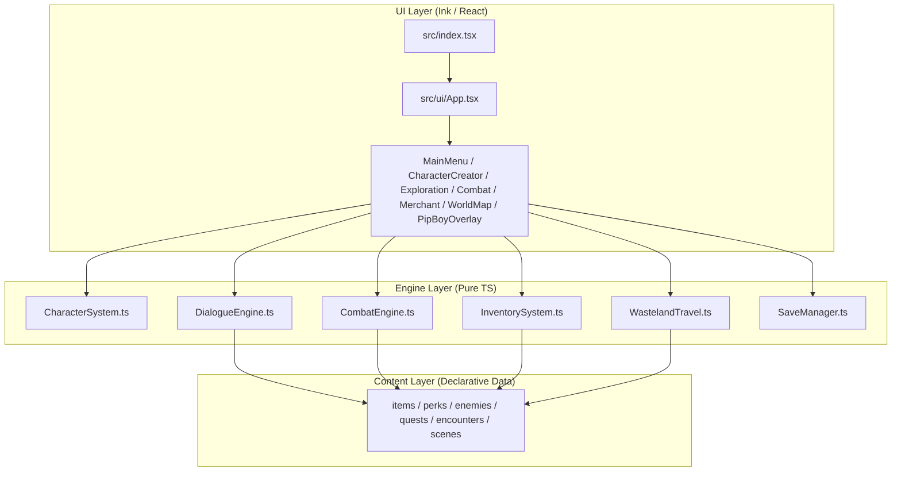

# Krypta 73: Popioły Nowego Świtu — Implementation Plan

> **For agentic workers:** REQUIRED SUB-SKILL: Use superpowers:subagent-driven-development to implement this plan task-by-task. Steps use checkbox (`- [ ]`) syntax for tracking.

**Goal:** Build a complete Fallout-inspired post-apocalyptic terminal RPG ("Krypta 73: Popioły Nowego Świtu") playable in the VS Code terminal using TypeScript, Ink (React TUI), and Vitest.

**Architecture:** Three-layer modular architecture: `src/types/` + `src/engine/` for pure, framework-agnostic RPG mechanics (S.P.E.C.I.A.L., skill checks, V.A.T.S. turn-based combat, radiation, inventory/trade, wasteland travel, JSON saves); `src/content/` for declarative data (items, perks, enemies, quests, encounters, branching scenes across 4 locations); and `src/ui/` for the Pip-Boy 3000 terminal user interface rendered with Ink.

**Architecture Diagram:**



**Tech Stack:** Node.js v24+, TypeScript 5+, Ink 5 (`ink`, `react`), `tsx` (execution), `vitest` (testing).

**Spec:** [2026-10-20-terminal-rpg-design.md](file:///C:/Users/jgorski/Projekty/RPG/docs/superpowers/specs/2026-10-20-terminal-rpg-design.md)

## Global Constraints

- Runtime: Node.js v24+ with ESM (`"type": "module"` in `package.json`).
- All engine modules (`src/engine/*.ts`) MUST be pure TypeScript with zero imports from `react` or `ink`.
- All UI text and game content MUST be in Polish (post-apocalyptic Fallout/Pip-Boy aesthetic).
- Every task must pass `npm test` (`vitest run`) and `npx tsc --noEmit` before committing.

---

### Task 1: Project Scaffolding, Domain Types, and Character/Perk System

**Files:**
- Create: `package.json`
- Create: `tsconfig.json`
- Create: `.gitignore`
- Create: `src/types/game.ts`
- Create: `src/content/perks.ts`
- Create: `src/engine/CharacterSystem.ts`
- Test: `tests/CharacterSystem.test.ts`

**Interfaces:**
- Produces:
  - `src/types/game.ts`: `AttributeKey`, `Attributes`, `PerkDefinition`, `ItemType`, `ItemDefinition`, `CharacterState`, `BodyPart`, `CombatState`, `SkillCheckSpec`, `ChoiceEffect`, `SceneChoice`, `SceneDefinition`, `QuestStage`, `QuestDefinition`, `LocationId`, `LocationDefinition`, `EncounterDefinition`, `GameState`
  - `src/content/perks.ts`: `PERKS: Record<string, PerkDefinition>`
  - `src/engine/CharacterSystem.ts`: `createInitialAttributes()`, `getBaseMaxHp(attributes, level, perks)`, `getEffectiveMaxHp(maxHp, rad)`, `getMaxAp(attributes)`, `calculateSkillCheckChance(state, check)`, `rollSkillCheck(state, check, rng?)`, `applyRadiation(state, rawRad)`, `grantXp(state, baseXp)`, `levelUpCharacter(state, attributeToIncrease, perkId)`, `createNewGameState(name, attributes)`

- [ ] **Step 1: Create `package.json`, `tsconfig.json`, `.gitignore` and install dependencies**

Create `package.json`:
```json
{
  "name": "krypta-73-rpg",
  "version": "1.0.0",
  "private": true,
  "type": "module",
  "scripts": {
    "start": "tsx src/index.tsx",
    "dev": "tsx watch src/index.tsx",
    "test": "vitest run",
    "typecheck": "tsc --noEmit"
  },
  "dependencies": {
    "ink": "^5.0.1",
    "react": "^18.3.1"
  },
  "devDependencies": {
    "@types/node": "^22.0.0",
    "@types/react": "^18.3.12",
    "tsx": "^4.19.2",
    "typescript": "^5.7.2",
    "vitest": "^2.1.8"
  }
}
```

Create `tsconfig.json`:
```json
{
  "compilerOptions": {
    "target": "ES2022",
    "module": "NodeNext",
    "moduleResolution": "NodeNext",
    "jsx": "react-jsx",
    "strict": true,
    "esModuleInterop": true,
    "skipLibCheck": true,
    "forceConsistentCasingInFileNames": true,
    "outDir": "dist"
  },
  "include": ["src/**/*", "tests/**/*"]
}
```

Create `.gitignore`:
```text
node_modules/
dist/
saves/
```

Run: `npm install`

- [ ] **Step 2: Write the failing test `tests/CharacterSystem.test.ts`**

```typescript
import { describe, it, expect } from 'vitest';
import {
  createInitialAttributes,
  getBaseMaxHp,
  getEffectiveMaxHp,
  getMaxAp,
  calculateSkillCheckChance,
  rollSkillCheck,
  applyRadiation,
  grantXp,
  levelUpCharacter,
  createNewGameState,
} from '../src/engine/CharacterSystem.js';

describe('CharacterSystem', () => {
  it('calculates base Max HP, effective Max HP with RAD, and Max AP accurately', () => {
    const attrs = { STR: 5, PER: 6, END: 6, CHA: 5, INT: 7, AGI: 6 };
    expect(getBaseMaxHp(attrs, 1, [])).toBe(130); // 70 + 6 * 10
    expect(getBaseMaxHp(attrs, 2, ['wasteland_toughness'])).toBe(160); // 130 + 10 (lvl 2) + 20 (perk)
    expect(getEffectiveMaxHp(100, 40)).toBe(80); // 40 RAD = -20%
    expect(getMaxAp(attrs)).toBe(8); // 5 + floor(6 / 2)
  });

  it('calculates skill check chance with attribute and perk modifiers', () => {
    const state = createNewGameState('Max', { STR: 5, PER: 5, END: 5, CHA: 5, INT: 7, AGI: 5 });
    const chance = calculateSkillCheckChance(state, { attribute: 'INT', difficulty: 6 });
    // 50 + (7 - 6) * 15 = 65%
    expect(chance).toBe(65);

    state.character.perks.push('robco_hacker');
    const boosted = calculateSkillCheckChance(state, { attribute: 'INT', difficulty: 6 });
    expect(boosted).toBe(85); // +20% from robco_hacker
  });

  it('rolls skill check deterministically with custom rng', () => {
    const state = createNewGameState('Max', createInitialAttributes());
    const successRoll = rollSkillCheck(state, { attribute: 'STR', difficulty: 5 }, () => 0.4);
    expect(successRoll.success).toBe(true);
    const failRoll = rollSkillCheck(state, { attribute: 'STR', difficulty: 5 }, () => 0.8);
    expect(failRoll.success).toBe(false);
  });

  it('applies radiation mitigated by END and lead_belly perk and clamps HP', () => {
    let state = createNewGameState('Max', { STR: 5, PER: 5, END: 5, CHA: 5, INT: 5, AGI: 5 });
    state = applyRadiation(state, 40);
    // END 5 reduces 40 by 15% => 34 RAD
    expect(state.character.rad).toBe(34);
    expect(state.character.hp).toBeLessThanOrEqual(getEffectiveMaxHp(state.character.maxHp, state.character.rad));
  });

  it('grants XP with INT bonus and handles level up with attribute + perk', () => {
    let state = createNewGameState('Max', { STR: 5, PER: 5, END: 5, CHA: 5, INT: 5, AGI: 5 });
    state = grantXp(state, 100); // 100 * (1 + 5*0.03) = 115 XP
    expect(state.character.xp).toBe(115);
    expect(state.character.pendingLevelUps).toBe(1);

    state = levelUpCharacter(state, 'PER', 'vats_sniper');
    expect(state.character.level).toBe(2);
    expect(state.character.attributes.PER).toBe(6);
    expect(state.character.perks).toContain('vats_sniper');
    expect(state.character.pendingLevelUps).toBe(0);
  });
});
```

- [ ] **Step 3: Run test to verify it fails**

Run: `npm test`
Expected: FAIL with module not found `../src/engine/CharacterSystem.js`.

- [ ] **Step 4: Implement `src/types/game.ts`, `src/content/perks.ts`, and `src/engine/CharacterSystem.ts`**

Create `src/types/game.ts`:
```typescript
export type AttributeKey = 'STR' | 'PER' | 'END' | 'CHA' | 'INT' | 'AGI';

export type Attributes = Record<AttributeKey, number>;

export interface PerkDefinition {
  id: string;
  name: string;
  description: string;
}

export type ItemType = 'weapon' | 'armor' | 'consumable' | 'quest';

export interface ItemDefinition {
  id: string;
  name: string;
  type: ItemType;
  description: string;
  value: number;
  damage?: number;
  accuracyBonus?: number;
  apCost?: number;
  isMelee?: boolean;
  defense?: number;
  radResistance?: number;
  healHp?: number;
  healRad?: number;
  combatDamage?: number;
  stunChance?: number;
}

export interface CharacterState {
  name: string;
  level: number;
  xp: number;
  pendingLevelUps: number;
  hp: number;
  maxHp: number;
  rad: number;
  caps: number;
  attributes: Attributes;
  perks: string[];
  equippedWeaponId: string | null;
  equippedArmorId: string | null;
  inventory: Record<string, number>;
}

export type BodyPart = 'head' | 'torso' | 'limbs';

export interface EnemyDefinition {
  id: string;
  name: string;
  description: string;
  maxHp: number;
  damage: number;
  accuracy: number;
  defense: number;
  radDamage: number;
  xpReward: number;
  capsReward: number;
  lootItemId?: string;
  isBoss?: boolean;
}

export interface CombatState {
  enemyId: string;
  enemyName: string;
  enemyHp: number;
  enemyMaxHp: number;
  enemyStunned: boolean;
  enemyWeakenedTurns: number;
  playerAp: number;
  playerMaxAp: number;
  playerDodgeBonus: number;
  turn: number;
  log: string[];
  victorySceneId: string;
  fleeSceneId?: string;
  isBoss: boolean;
}

export interface SkillCheckSpec {
  attribute: AttributeKey;
  difficulty: number;
}

export interface ChoiceEffect {
  hpDelta?: number;
  radDelta?: number;
  capsDelta?: number;
  xpDelta?: number;
  addItems?: Record<string, number>;
  removeItems?: Record<string, number>;
  setFlags?: Record<string, boolean>;
  setQuestState?: { questId: string; status: 'active' | 'completed' | 'failed'; stage?: string };
  startCombat?: { enemyId: string; victorySceneId: string; fleeSceneId?: string };
  openMerchant?: string;
  openWorldMap?: boolean;
  changeLocation?: LocationId;
}

export interface SceneChoice {
  id: string;
  text: string;
  requiredFlag?: string;
  forbiddenFlag?: string;
  requiredItem?: string;
  requiredCaps?: number;
  skillCheck?: SkillCheckSpec;
  nextSceneId: string;
  failSceneId?: string;
  effect?: ChoiceEffect;
  failEffect?: ChoiceEffect;
}

export type LocationId = 'vault_73' | 'rusty_crater' | 'robco_relay' | 'rust_fortress';

export interface SceneDefinition {
  id: string;
  title: string;
  locationId: LocationId;
  description: string;
  onEnterEffect?: ChoiceEffect;
  choices: SceneChoice[];
  isEnding?: boolean;
}

export interface QuestStateEntry {
  status: 'active' | 'completed' | 'failed';
  stage: string;
}

export interface QuestDefinition {
  id: string;
  title: string;
  description: string;
  stages: Record<string, string>;
}

export interface LocationDefinition {
  id: LocationId;
  name: string;
  description: string;
  entrySceneId: string;
  requiredFlag?: string;
}

export interface EncounterDefinition {
  id: string;
  title: string;
  description: string;
  choices: SceneChoice[];
}

export interface MerchantDefinition {
  id: string;
  name: string;
  greeting: string;
  stock: string[];
}

export interface GameState {
  character: CharacterState;
  currentLocationId: LocationId;
  currentSceneId: string;
  flags: Record<string, boolean>;
  quests: Record<string, QuestStateEntry>;
  combat: CombatState | null;
  activeMerchantId: string | null;
  pendingDestinationSceneId: string | null;
  eventLog: string[];
}
```

Create `src/content/perks.ts`:
```typescript
import { PerkDefinition } from '../types/game.js';

export const PERKS: Record<string, PerkDefinition> = {
  vats_sniper: {
    id: 'vats_sniper',
    name: 'Snajper V.A.T.S.',
    description: '+15% do szansy trafienia w głowę w systemie V.A.T.S.',
  },
  robco_hacker: {
    id: 'robco_hacker',
    name: 'Haker RobCo',
    description: '+20% do testów Inteligencji oraz hakowania terminali.',
  },
  wasteland_toughness: {
    id: 'wasteland_toughness',
    name: 'Twardziel Pustkowi',
    description: '+20 do maksymalnego HP oraz +3 do obrony pancerza.',
  },
  golden_tongue: {
    id: 'golden_tongue',
    name: 'Złoty Język',
    description: '+20% do testów Charyzmy oraz 15% korzystniejsze ceny u kupców.',
  },
  lead_belly: {
    id: 'lead_belly',
    name: 'Ołowiany Brzuch',
    description: 'Zmniejsza otrzymywane skażenie promieniowaniem (RAD) o 50%.',
  },
};
```

Create `src/engine/CharacterSystem.ts`:
```typescript
import {
  AttributeKey,
  Attributes,
  CharacterState,
  GameState,
  SkillCheckSpec,
} from '../types/game.js';

export const XP_THRESHOLDS = [0, 100, 250, 450, 700, 1000];

export function createInitialAttributes(): Attributes {
  return { STR: 5, PER: 5, END: 5, CHA: 5, INT: 5, AGI: 5 };
}

export function getBaseMaxHp(attributes: Attributes, level: number, perks: string[]): number {
  const base = 70 + attributes.END * 10 + (level - 1) * 10;
  const perkBonus = perks.includes('wasteland_toughness') ? 20 : 0;
  return base + perkBonus;
}

export function getEffectiveMaxHp(maxHp: number, rad: number): number {
  const clampedRad = Math.max(0, Math.min(90, rad));
  const multiplier = 1 - clampedRad * 0.005;
  return Math.max(10, Math.round(maxHp * multiplier));
}

export function getMaxAp(attributes: Attributes): number {
  return 5 + Math.floor(attributes.AGI / 2);
}

export function calculateSkillCheckChance(state: GameState, check: SkillCheckSpec): number {
  const attrVal = state.character.attributes[check.attribute];
  if (attrVal >= check.difficulty + 2) {
    return 100;
  }
  let bonus = 0;
  if (check.attribute === 'INT' && state.character.perks.includes('robco_hacker')) {
    bonus += 20;
  }
  if (check.attribute === 'CHA' && state.character.perks.includes('golden_tongue')) {
    bonus += 20;
  }
  const raw = 50 + (attrVal - check.difficulty) * 15 + bonus;
  return Math.max(10, Math.min(95, raw));
}

export function rollSkillCheck(
  state: GameState,
  check: SkillCheckSpec,
  rng: () => number = Math.random
): { success: boolean; chance: number; roll: number } {
  const chance = calculateSkillCheckChance(state, check);
  const roll = Math.floor(rng() * 100) + 1;
  return {
    success: roll <= chance,
    chance,
    roll,
  };
}

export function applyRadiation(state: GameState, rawRad: number): GameState {
  if (rawRad === 0) return state;
  let delta = rawRad;
  if (rawRad > 0) {
    const endMitigation = 1 - state.character.attributes.END * 0.03;
    const perkMitigation = state.character.perks.includes('lead_belly') ? 0.5 : 1;
    delta = Math.max(1, Math.round(rawRad * endMitigation * perkMitigation));
  }
  const newRad = Math.max(0, Math.min(90, state.character.rad + delta));
  const effectiveMax = getEffectiveMaxHp(state.character.maxHp, newRad);
  const newHp = Math.min(state.character.hp, effectiveMax);

  return {
    ...state,
    character: {
      ...state.character,
      rad: newRad,
      hp: newHp,
    },
  };
}

export function grantXp(state: GameState, baseXp: number): GameState {
  if (baseXp <= 0) return state;
  const intBonus = 1 + state.character.attributes.INT * 0.03;
  const gained = Math.round(baseXp * intBonus);
  const newXp = state.character.xp + gained;

  let targetLevel = state.character.level + state.character.pendingLevelUps;
  let newPending = state.character.pendingLevelUps;
  while (targetLevel < XP_THRESHOLDS.length && newXp >= XP_THRESHOLDS[targetLevel]) {
    newPending += 1;
    targetLevel += 1;
  }

  return {
    ...state,
    character: {
      ...state.character,
      xp: newXp,
      pendingLevelUps: newPending,
    },
    eventLog: [...state.eventLog.slice(-19), `Zdobyto ${gained} XP.`],
  };
}

export function levelUpCharacter(
  state: GameState,
  attributeToIncrease: AttributeKey,
  perkId: string
): GameState {
  if (state.character.pendingLevelUps <= 0) return state;

  const newLevel = state.character.level + 1;
  const newAttributes: Attributes = {
    ...state.character.attributes,
    [attributeToIncrease]: Math.min(10, state.character.attributes[attributeToIncrease] + 1),
  };
  const newPerks = state.character.perks.includes(perkId)
    ? state.character.perks
    : [...state.character.perks, perkId];
  const newMaxHp = getBaseMaxHp(newAttributes, newLevel, newPerks);
  const effectiveMax = getEffectiveMaxHp(newMaxHp, state.character.rad);

  return {
    ...state,
    character: {
      ...state.character,
      level: newLevel,
      pendingLevelUps: state.character.pendingLevelUps - 1,
      attributes: newAttributes,
      perks: newPerks,
      maxHp: newMaxHp,
      hp: effectiveMax,
    },
    eventLog: [
      ...state.eventLog.slice(-19),
      `Awans na poziom ${newLevel}! (+1 ${attributeToIncrease}, nowy Perk: ${perkId})`,
    ],
  };
}

export function createNewGameState(name: string, attributes: Attributes): GameState {
  const maxHp = getBaseMaxHp(attributes, 1, []);
  const character: CharacterState = {
    name: name.trim() || 'Wędrowiec z Krypty',
    level: 1,
    xp: 0,
    pendingLevelUps: 0,
    hp: maxHp,
    maxHp,
    rad: 0,
    caps: 50,
    attributes,
    perks: [],
    equippedWeaponId: 'pipe_pistol',
    equippedArmorId: 'vault_suit',
    inventory: {
      pipe_pistol: 1,
      vault_suit: 1,
      stimpak: 2,
      radaway: 1,
    },
  };

  return {
    character,
    currentLocationId: 'vault_73',
    currentSceneId: 'vault_intro',
    flags: {},
    quests: {
      main_stabilizer: {
        status: 'active',
        stage: 'talk_overseer',
      },
    },
    combat: null,
    activeMerchantId: null,
    pendingDestinationSceneId: null,
    eventLog: ['System Pip-Boy 3000 MK IV zainicjalizowany.'],
  };
}
```

- [ ] **Step 5: Run tests and commit**

Run: `npm test`
Expected: PASS

```bash
git add package.json package-lock.json tsconfig.json .gitignore src/types/game.ts src/content/perks.ts src/engine/CharacterSystem.ts tests/CharacterSystem.test.ts
git commit -m "feat: add project setup, domain types, and character system"
```

---

### Task 2: Inventory, Equipment, Medical Items, and Trade Engine

**Files:**
- Create: `src/content/items.ts`
- Create: `src/engine/InventorySystem.ts`
- Test: `tests/InventorySystem.test.ts`

**Interfaces:**
- Consumes: `src/types/game.ts`, `src/engine/CharacterSystem.ts` (`getEffectiveMaxHp`, `applyRadiation`)
- Produces:
  - `src/content/items.ts`: `ITEMS: Record<string, ItemDefinition>`, `MERCHANTS: Record<string, MerchantDefinition>`
  - `src/engine/InventorySystem.ts`: `addItem(state, itemId, qty)`, `removeItem(state, itemId, qty)`, `equipItem(state, itemId)`, `useConsumable(state, itemId)`, `getBuyPrice(state, itemId)`, `getSellPrice(state, itemId)`, `buyItem(state, itemId)`, `sellItem(state, itemId)`

- [ ] **Step 1: Write the failing test `tests/InventorySystem.test.ts`**

```typescript
import { describe, it, expect } from 'vitest';
import { createNewGameState, createInitialAttributes } from '../src/engine/CharacterSystem.js';
import {
  addItem,
  equipItem,
  useConsumable,
  getBuyPrice,
  getSellPrice,
  buyItem,
  sellItem,
} from '../src/engine/InventorySystem.js';

describe('InventorySystem', () => {
  it('equips weapons and armor from inventory', () => {
    let state = createNewGameState('Max', createInitialAttributes());
    state = addItem(state, 'laser_rifle', 1);
    state = equipItem(state, 'laser_rifle');
    expect(state.character.equippedWeaponId).toBe('laser_rifle');
  });

  it('uses stimpak with INT bonus and radaway to reduce RAD', () => {
    let state = createNewGameState('Max', { STR: 5, PER: 5, END: 5, CHA: 5, INT: 6, AGI: 5 });
    state.character.rad = 30;
    state.character.hp = 40;
    state = useConsumable(state, 'stimpak');
    // base 35 + INT(6)*3 = 53 => 40 + 53 = 93
    expect(state.character.hp).toBe(93);
    expect(state.character.inventory.stimpak).toBe(1);

    state = useConsumable(state, 'radaway');
    expect(state.character.rad).toBe(0);
    expect(state.character.inventory.radaway).toBeUndefined();
  });

  it('calculates buy/sell prices with CHA and golden_tongue perk and processes trade', () => {
    let state = createNewGameState('Max', { STR: 5, PER: 5, END: 5, CHA: 7, INT: 5, AGI: 5 });
    state.character.caps = 200;
    const buyPrice = getBuyPrice(state, 'stimpak');
    const sellPrice = getSellPrice(state, 'stimpak');
    expect(buyPrice).toBeGreaterThan(sellPrice);

    state = buyItem(state, 'stimpak');
    expect(state.character.caps).toBe(200 - buyPrice);
    expect(state.character.inventory.stimpak).toBe(3);

    state = sellItem(state, 'stimpak');
    expect(state.character.inventory.stimpak).toBe(2);
  });
});
```

- [ ] **Step 2: Run test to verify it fails**

Run: `npm test`
Expected: FAIL with module not found `../src/engine/InventorySystem.js`.

- [ ] **Step 3: Implement `src/content/items.ts` and `src/engine/InventorySystem.ts`**

Create `src/content/items.ts`:
```typescript
import { ItemDefinition, MerchantDefinition } from '../types/game.js';

export const ITEMS: Record<string, ItemDefinition> = {
  pipe_pistol: {
    id: 'pipe_pistol',
    name: 'Pistolet Samoróbka 10mm',
    type: 'weapon',
    description: 'Zardzewiały, ale niezawodny pistolet półautomatyczny z Krypty.',
    value: 45,
    damage: 14,
    accuracyBonus: 5,
    apCost: 3,
    isMelee: false,
  },
  rusty_machete: {
    id: 'rusty_machete',
    name: 'Zębata Maczeta',
    type: 'weapon',
    description: 'Ciężkie ostrze wykute z resora samochodowego. Korzysta z Siły.',
    value: 40,
    damage: 16,
    accuracyBonus: 10,
    apCost: 3,
    isMelee: true,
  },
  laser_rifle: {
    id: 'laser_rifle',
    name: 'Karabin Laserowy AER9',
    type: 'weapon',
    description: 'Przedwojenna broń energetyczna o wysokiej precyzji.',
    value: 140,
    damage: 26,
    accuracyBonus: 15,
    apCost: 3,
    isMelee: false,
  },
  plasma_blade: {
    id: 'plasma_blade',
    name: 'Ostrze Plazmowe RobCo',
    type: 'weapon',
    description: 'Prototypowe ostrze przecinające pancerze wspomagane.',
    value: 160,
    damage: 28,
    accuracyBonus: 12,
    apCost: 3,
    isMelee: true,
  },
  vault_suit: {
    id: 'vault_suit',
    name: 'Kombinezon Krypty 73',
    type: 'armor',
    description: 'Standardowy niebiesko-żółty kombinezon z podstawową izolacją.',
    value: 35,
    defense: 3,
    radResistance: 10,
  },
  leather_armor: {
    id: 'leather_armor',
    name: 'Wzmocniony Pancerz Skórzany',
    type: 'armor',
    description: 'Solidna kurtka z płytami ze stalowego złomu.',
    value: 90,
    defense: 7,
    radResistance: 15,
  },
  recon_armor: {
    id: 'recon_armor',
    name: 'Pancerz Zwiadowczy Bractwa',
    type: 'armor',
    description: 'Zaawansowany pancerz kompozytowy z filtrami przeciwpromiennymi.',
    value: 180,
    defense: 12,
    radResistance: 35,
  },
  stimpak: {
    id: 'stimpak',
    name: 'Stimpak',
    type: 'consumable',
    description: 'Autostrzykawka regenerująca tkanki (+35 HP + bonus z INT).',
    value: 35,
    healHp: 35,
  },
  radaway: {
    id: 'radaway',
    name: 'AntyRad (RadAway)',
    type: 'consumable',
    description: 'Dożylny preparat wypłukujący izotopy promieniotwórcze (-35 RAD).',
    value: 40,
    healRad: 35,
  },
  pulse_grenade: {
    id: 'pulse_grenade',
    name: 'Granat Pulsacyjny',
    type: 'consumable',
    description: 'Ładunek EMP zadający 35 obrażeń i ogłuszający cel.',
    value: 55,
    combatDamage: 35,
    stunChance: 80,
  },
  security_keycard: {
    id: 'security_keycard',
    name: 'Karta Dostępu Strażnika',
    type: 'quest',
    description: 'Magnetyczna przepustka otwierająca zbrojownię i śluzę Krypty 73.',
    value: 0,
  },
  medical_crate: {
    id: 'medical_crate',
    name: 'Skrzynka Medyczna Doktor Igi',
    type: 'quest',
    description: 'Zapieczętowany pojemnik z przedwojennymi antybiotykami.',
    value: 0,
  },
  robco_holotape: {
    id: 'robco_holotape',
    name: 'Holotaśma Nadzorcza RobCo',
    type: 'quest',
    description: 'Zawiera kody dostępu do wieżyczek w Twierdzy Dzieci Rdzy.',
    value: 0,
  },
  geck_stabilizer: {
    id: 'geck_stabilizer',
    name: 'Moduł Stabilizatora G.E.C.K.-Lite',
    type: 'quest',
    description: 'Kluczowy podzespół zdolny uratować reaktor Krypty 73.',
    value: 0,
  },
};

export const MERCHANTS: Record<string, MerchantDefinition> = {
  szrot_trader: {
    id: 'szrot_trader',
    name: 'Kupiec Szrot (Złomowisko)',
    greeting: '„Kapsle na stół, Wędrowcze! Mam sprzęt prosto z przedwojennych ruin.”',
    stock: [
      'stimpak',
      'radaway',
      'pulse_grenade',
      'rusty_machete',
      'leather_armor',
      'laser_rifle',
      'recon_armor',
    ],
  },
  caravan_trader: {
    id: 'caravan_trader',
    name: 'Wędrowny Karawaniarz',
    greeting: '„Na Pustkowiach bez zapasu Stimpaków daleko nie zajedziesz. Handlujemy?”',
    stock: ['stimpak', 'radaway', 'pulse_grenade', 'leather_armor', 'plasma_blade'],
  },
};
```

Create `src/engine/InventorySystem.ts`:
```typescript
import { ITEMS } from '../content/items.js';
import { GameState } from '../types/game.js';
import { getEffectiveMaxHp } from './CharacterSystem.js';

export function addItem(state: GameState, itemId: string, qty = 1): GameState {
  if (qty <= 0 || !ITEMS[itemId]) return state;
  const current = state.character.inventory[itemId] ?? 0;
  return {
    ...state,
    character: {
      ...state.character,
      inventory: {
        ...state.character.inventory,
        [itemId]: current + qty,
      },
    },
  };
}

export function removeItem(state: GameState, itemId: string, qty = 1): GameState {
  const current = state.character.inventory[itemId] ?? 0;
  if (current <= 0 || qty <= 0) return state;
  const nextQty = current - qty;
  const nextInv = { ...state.character.inventory };
  if (nextQty <= 0) {
    delete nextInv[itemId];
  } else {
    nextInv[itemId] = nextQty;
  }

  let equippedWeaponId = state.character.equippedWeaponId;
  let equippedArmorId = state.character.equippedArmorId;
  if (!nextInv[itemId]) {
    if (equippedWeaponId === itemId) equippedWeaponId = null;
    if (equippedArmorId === itemId) equippedArmorId = null;
  }

  return {
    ...state,
    character: {
      ...state.character,
      inventory: nextInv,
      equippedWeaponId,
      equippedArmorId,
    },
  };
}

export function equipItem(state: GameState, itemId: string): GameState {
  const item = ITEMS[itemId];
  const qty = state.character.inventory[itemId] ?? 0;
  if (!item || qty <= 0) return state;

  if (item.type === 'weapon') {
    return {
      ...state,
      character: {
        ...state.character,
        equippedWeaponId: itemId,
      },
      eventLog: [...state.eventLog.slice(-19), `Wyposażono broń: ${item.name}`],
    };
  }
  if (item.type === 'armor') {
    return {
      ...state,
      character: {
        ...state.character,
        equippedArmorId: itemId,
      },
      eventLog: [...state.eventLog.slice(-19), `Założono pancerz: ${item.name}`],
    };
  }
  return state;
}

export function useConsumable(state: GameState, itemId: string): GameState {
  const item = ITEMS[itemId];
  const qty = state.character.inventory[itemId] ?? 0;
  if (!item || item.type !== 'consumable' || qty <= 0) return state;
  if (!item.healHp && !item.healRad) return state;

  let nextState = removeItem(state, itemId, 1);
  let newRad = nextState.character.rad;
  if (item.healRad) {
    newRad = Math.max(0, newRad - item.healRad);
  }
  const effectiveMax = getEffectiveMaxHp(nextState.character.maxHp, newRad);
  let newHp = nextState.character.hp;
  if (item.healHp) {
    const intBonus = nextState.character.attributes.INT * 3;
    newHp = Math.min(effectiveMax, newHp + item.healHp + intBonus);
  } else {
    newHp = Math.min(effectiveMax, newHp);
  }

  return {
    ...nextState,
    character: {
      ...nextState.character,
      rad: newRad,
      hp: newHp,
    },
    eventLog: [...nextState.eventLog.slice(-19), `Użyto: ${item.name}`],
  };
}

export function getBuyPrice(state: GameState, itemId: string): number {
  const item = ITEMS[itemId];
  if (!item) return 0;
  const chaFactor = 1 - (state.character.attributes.CHA - 5) * 0.03;
  const perkFactor = state.character.perks.includes('golden_tongue') ? 0.85 : 1;
  return Math.max(5, Math.round(item.value * 1.2 * chaFactor * perkFactor));
}

export function getSellPrice(state: GameState, itemId: string): number {
  const item = ITEMS[itemId];
  if (!item || item.type === 'quest') return 0;
  const chaFactor = 1 + (state.character.attributes.CHA - 5) * 0.03;
  const perkFactor = state.character.perks.includes('golden_tongue') ? 1.15 : 1;
  const buyPrice = getBuyPrice(state, itemId);
  return Math.min(
    buyPrice - 1,
    Math.max(1, Math.round(item.value * 0.55 * chaFactor * perkFactor))
  );
}

export function buyItem(state: GameState, itemId: string): GameState {
  const item = ITEMS[itemId];
  if (!item) return state;
  const price = getBuyPrice(state, itemId);
  if (state.character.caps < price) return state;

  const afterAdd = addItem(state, itemId, 1);
  return {
    ...afterAdd,
    character: {
      ...afterAdd.character,
      caps: afterAdd.character.caps - price,
    },
    eventLog: [...afterAdd.eventLog.slice(-19), `Kupiono ${item.name} za ${price} kapsli.`],
  };
}

export function sellItem(state: GameState, itemId: string): GameState {
  const item = ITEMS[itemId];
  const qty = state.character.inventory[itemId] ?? 0;
  if (!item || item.type === 'quest' || qty <= 0) return state;

  const price = getSellPrice(state, itemId);
  const afterRemove = removeItem(state, itemId, 1);
  return {
    ...afterRemove,
    character: {
      ...afterRemove.character,
      caps: afterRemove.character.caps + price,
    },
    eventLog: [...afterRemove.eventLog.slice(-19), `Sprzedano ${item.name} za ${price} kapsli.`],
  };
}
```

- [ ] **Step 4: Run tests and commit**

Run: `npm test`
Expected: PASS

```bash
git add src/content/items.ts src/engine/InventorySystem.ts tests/InventorySystem.test.ts
git commit -m "feat: add items catalog and inventory/trade system"
```

---

### Task 3: Turn-Based Combat Engine with V.A.T.S. and Radiation

**Files:**
- Create: `src/content/enemies.ts`
- Create: `src/engine/CombatEngine.ts`
- Test: `tests/CombatEngine.test.ts`

**Interfaces:**
- Consumes: `src/types/game.ts`, `src/content/items.ts`, `src/engine/CharacterSystem.ts`, `src/engine/InventorySystem.ts`
- Produces:
  - `src/content/enemies.ts`: `ENEMIES: Record<string, EnemyDefinition>`
  - `src/engine/CombatEngine.ts`: `startCombat(state, enemyId, victorySceneId, fleeSceneId?)`, `getVatsHitChance(state, part)`, `performPlayerAttack(state, mode, part?, rng?)`, `useCombatItem(state, itemId, rng?)`, `endPlayerTurn(state, rng?)`, `attemptFlee(state, rng?)`

- [ ] **Step 1: Write the failing test `tests/CombatEngine.test.ts`**

```typescript
import { describe, it, expect } from 'vitest';
import { createNewGameState, createInitialAttributes } from '../src/engine/CharacterSystem.js';
import {
  startCombat,
  getVatsHitChance,
  performPlayerAttack,
  endPlayerTurn,
  attemptFlee,
} from '../src/engine/CombatEngine.js';

describe('CombatEngine', () => {
  it('initializes combat state with enemy and player AP', () => {
    let state = createNewGameState('Max', createInitialAttributes());
    state = startCombat(state, 'feral_ghoul', 'vault_gate');
    expect(state.combat).not.toBeNull();
    expect(state.combat?.enemyName).toBe('Zdziczały Ghul');
    expect(state.combat?.playerAp).toBe(7);
  });

  it('calculates V.A.T.S. hit chances and applies headshot damage + stun on low rng', () => {
    let state = createNewGameState('Max', { STR: 5, PER: 8, END: 5, CHA: 5, INT: 5, AGI: 6 });
    state = startCombat(state, 'feral_ghoul', 'vault_gate');
    const headChance = getVatsHitChance(state, 'head');
    const torsoChance = getVatsHitChance(state, 'torso');
    expect(torsoChance).toBeGreaterThan(headChance);

    const beforeHp = state.combat!.enemyHp;
    state = performPlayerAttack(state, 'vats', 'head', () => 0.1);
    expect(state.combat!.enemyHp).toBeLessThan(beforeHp);
    expect(state.combat!.enemyStunned).toBe(true);
    expect(state.combat!.playerAp).toBe(4); // 8 - 4
  });

  it('transitions to victorySceneId and awards XP + caps when enemy dies', () => {
    let state = createNewGameState('Max', createInitialAttributes());
    state = startCombat(state, 'feral_ghoul', 'vault_gate');
    state.combat!.enemyHp = 5;
    state = performPlayerAttack(state, 'standard', 'torso', () => 0.1);
    expect(state.combat).toBeNull();
    expect(state.currentSceneId).toBe('vault_gate');
    expect(state.character.xp).toBeGreaterThan(0);
  });

  it('executes enemy turn when player ends turn and refreshes AP', () => {
    let state = createNewGameState('Max', createInitialAttributes());
    state = startCombat(state, 'feral_ghoul', 'vault_gate');
    const beforeHp = state.character.hp;
    state = endPlayerTurn(state, () => 0.1);
    expect(state.character.hp).toBeLessThan(beforeHp);
    expect(state.combat?.turn).toBe(2);
    expect(state.combat?.playerAp).toBe(state.combat?.playerMaxAp);
  });

  it('allows fleeing from non-boss enemies on successful AGI roll', () => {
    let state = createNewGameState('Max', createInitialAttributes());
    state = startCombat(state, 'wasteland_raider', 'crater_hub', 'crater_hub');
    state = attemptFlee(state, () => 0.1);
    expect(state.combat).toBeNull();
    expect(state.currentSceneId).toBe('crater_hub');
  });
});
```

- [ ] **Step 2: Run test to verify it fails**

Run: `npm test`
Expected: FAIL with module not found `../src/engine/CombatEngine.js`.

- [ ] **Step 3: Implement `src/content/enemies.ts` and `src/engine/CombatEngine.ts`**

Create `src/content/enemies.ts`:
```typescript
import { EnemyDefinition } from '../types/game.js';

export const ENEMIES: Record<string, EnemyDefinition> = {
  damaged_protectron: {
    id: 'damaged_protectron',
    name: 'Uszkodzony Strażnik RobCo',
    description: 'Iskrzący automat strażniczy z zablokowanym protokołem pacyfikacji.',
    maxHp: 45,
    damage: 11,
    accuracy: 65,
    defense: 4,
    radDamage: 0,
    xpReward: 55,
    capsReward: 20,
    lootItemId: 'security_keycard',
  },
  feral_ghoul: {
    id: 'feral_ghoul',
    name: 'Zdziczały Ghul',
    description: 'Napromieniowany nieszczęśnik o wyostrzonych instynktach drapieżnika.',
    maxHp: 50,
    damage: 13,
    accuracy: 70,
    defense: 2,
    radDamage: 8,
    xpReward: 65,
    capsReward: 18,
  },
  wasteland_raider: {
    id: 'wasteland_raider',
    name: 'Bandyta z Pustkowi',
    description: 'Uzbrojony w samoróbki łupieżca polujący na karawany.',
    maxHp: 65,
    damage: 16,
    accuracy: 72,
    defense: 4,
    radDamage: 0,
    xpReward: 80,
    capsReward: 38,
    lootItemId: 'stimpak',
  },
  rad_scorpion: {
    id: 'rad_scorpion',
    name: 'Radskorpion Pustynny',
    description: 'Olbrzymi pajęczak z chitynowym pancerzem i radioaktywnym jadem.',
    maxHp: 80,
    damage: 19,
    accuracy: 75,
    defense: 6,
    radDamage: 10,
    xpReward: 100,
    capsReward: 25,
    lootItemId: 'radaway',
  },
  robco_sentry: {
    id: 'robco_sentry',
    name: 'Wieżyczka Bojowa RobCo MK II',
    description: 'Ciężki automat strażniczy wyposażony w podwójny emiter laserowy.',
    maxHp: 90,
    damage: 21,
    accuracy: 78,
    defense: 7,
    radDamage: 0,
    xpReward: 120,
    capsReward: 50,
    lootItemId: 'laser_rifle',
  },
  warlord_korg: {
    id: 'warlord_korg',
    name: 'Watażka Korg (Dowódca Dzieci Rdzy)',
    description: 'Zakonserwowany w improwizowanym pancerzu wspomaganym fanatyk.',
    maxHp: 135,
    damage: 25,
    accuracy: 80,
    defense: 9,
    radDamage: 6,
    xpReward: 220,
    capsReward: 150,
    lootItemId: 'geck_stabilizer',
    isBoss: true,
  },
};
```

Create `src/engine/CombatEngine.ts`:
```typescript
import { ENEMIES } from '../content/enemies.js';
import { ITEMS } from '../content/items.js';
import { BodyPart, GameState } from '../types/game.js';
import { applyRadiation, getMaxAp, grantXp } from './CharacterSystem.js';
import { addItem, removeItem, useConsumable } from './InventorySystem.js';

export function startCombat(
  state: GameState,
  enemyId: string,
  victorySceneId: string,
  fleeSceneId?: string
): GameState {
  const enemy = ENEMIES[enemyId];
  if (!enemy) return state;
  const maxAp = getMaxAp(state.character.attributes);

  return {
    ...state,
    combat: {
      enemyId: enemy.id,
      enemyName: enemy.name,
      enemyHp: enemy.maxHp,
      enemyMaxHp: enemy.maxHp,
      enemyStunned: false,
      enemyWeakenedTurns: 0,
      playerAp: maxAp,
      playerMaxAp: maxAp,
      playerDodgeBonus: 0,
      turn: 1,
      log: [`Rozpoczęto starcie: ${enemy.name}!`],
      victorySceneId,
      fleeSceneId,
      isBoss: Boolean(enemy.isBoss),
    },
  };
}

export function getVatsHitChance(state: GameState, part: BodyPart): number {
  const weapon = state.character.equippedWeaponId
    ? ITEMS[state.character.equippedWeaponId]
    : null;
  const weaponAcc = weapon?.accuracyBonus ?? 0;
  const base = 65 + state.character.attributes.PER * 3 + weaponAcc;

  let modifier = 0;
  if (part === 'head') {
    modifier = -25 + (state.character.perks.includes('vats_sniper') ? 15 : 0);
  } else if (part === 'limbs') {
    modifier = -15;
  }

  return Math.max(15, Math.min(95, base + modifier));
}

function resolveCombatVictory(state: GameState): GameState {
  const combat = state.combat;
  if (!combat) return state;
  const enemy = ENEMIES[combat.enemyId];
  let nextState: GameState = {
    ...state,
    combat: null,
    currentSceneId: combat.victorySceneId,
    character: {
      ...state.character,
      caps: state.character.caps + (enemy?.capsReward ?? 0),
    },
    eventLog: [
      ...state.eventLog.slice(-19),
      `Pokonano: ${combat.enemyName}! (+${enemy?.capsReward ?? 0} kapsli)`,
    ],
  };

  if (enemy?.lootItemId) {
    nextState = addItem(nextState, enemy.lootItemId, 1);
  }
  if (enemy?.xpReward) {
    nextState = grantXp(nextState, enemy.xpReward);
  }
  return nextState;
}

export function performPlayerAttack(
  state: GameState,
  mode: 'standard' | 'vats',
  part: BodyPart = 'torso',
  rng: () => number = Math.random
): GameState {
  const combat = state.combat;
  if (!combat) return state;

  const apCost = mode === 'vats' ? 4 : 3;
  if (combat.playerAp < apCost) {
    return {
      ...state,
      combat: {
        ...combat,
        log: [...combat.log.slice(-7), 'Brak wystarczających Punktów Akcji (AP)!'],
      },
    };
  }

  const weapon = state.character.equippedWeaponId
    ? ITEMS[state.character.equippedWeaponId]
    : null;
  const baseDamage =
    (weapon?.damage ?? 8) +
    (weapon?.isMelee ? state.character.attributes.STR : Math.floor(state.character.attributes.PER / 2));

  const targetPart: BodyPart = mode === 'standard' ? 'torso' : part;
  const hitChance =
    mode === 'standard'
      ? Math.max(25, Math.min(95, 70 + state.character.attributes.PER * 3 + (weapon?.accuracyBonus ?? 0)))
      : getVatsHitChance(state, targetPart);

  const roll = Math.floor(rng() * 100) + 1;
  const remainingAp = combat.playerAp - apCost;

  if (roll > hitChance) {
    return {
      ...state,
      combat: {
        ...combat,
        playerAp: remainingAp,
        log: [
          ...combat.log.slice(-7),
          `Chybienie! (${mode === 'vats' ? `V.A.T.S. ${targetPart}` : 'Atak'} - szansa ${hitChance}%)`,
        ],
      },
    };
  }

  const enemy = ENEMIES[combat.enemyId];
  let mult = 1.0;
  if (mode === 'vats') {
    if (targetPart === 'head') mult = 1.75;
    else if (targetPart === 'torso') mult = 1.15;
    else mult = 0.85;
  }

  const rawDamage = Math.round(baseDamage * mult);
  const finalDamage = Math.max(2, rawDamage - (enemy?.defense ?? 0));
  const nextEnemyHp = Math.max(0, combat.enemyHp - finalDamage);

  let enemyStunned = combat.enemyStunned;
  let enemyWeakenedTurns = combat.enemyWeakenedTurns;
  const extraEffects: string[] = [];

  if (mode === 'vats' && targetPart === 'head' && rng() <= 0.25) {
    enemyStunned = true;
    extraEffects.push('OGŁUSZENIE');
  }
  if (mode === 'vats' && targetPart === 'limbs') {
    enemyWeakenedTurns = 2;
    extraEffects.push('OSŁABIENIE');
  }

  const updatedState: GameState = {
    ...state,
    combat: {
      ...combat,
      enemyHp: nextEnemyHp,
      enemyStunned,
      enemyWeakenedTurns,
      playerAp: remainingAp,
      log: [
        ...combat.log.slice(-7),
        `Trafienie za ${finalDamage} pkt obrażeń!${extraEffects.length ? ` [${extraEffects.join(', ')}]` : ''}`,
      ],
    },
  };

  if (nextEnemyHp <= 0) {
    return resolveCombatVictory(updatedState);
  }
  return updatedState;
}

export function useCombatItem(
  state: GameState,
  itemId: string,
  rng: () => number = Math.random
): GameState {
  const combat = state.combat;
  const item = ITEMS[itemId];
  if (!combat || !item || (state.character.inventory[itemId] ?? 0) <= 0) return state;
  if (combat.playerAp < 2) {
    return {
      ...state,
      combat: {
        ...combat,
        log: [...combat.log.slice(-7), 'Za mało AP (wymagane 2 AP)!'],
      },
    };
  }

  if (item.combatDamage) {
    let nextState = removeItem(state, itemId, 1);
    const nextEnemyHp = Math.max(0, combat.enemyHp - item.combatDamage);
    const stunned = item.stunChance ? rng() * 100 <= item.stunChance : false;
    nextState = {
      ...nextState,
      combat: {
        ...combat,
        playerAp: combat.playerAp - 2,
        enemyHp: nextEnemyHp,
        enemyStunned: combat.enemyStunned || stunned,
        log: [
          ...combat.log.slice(-7),
          `Rzucono ${item.name}: ${item.combatDamage} obrażeń!${stunned ? ' [OGŁUSZENIE]' : ''}`,
        ],
      },
    };
    if (nextEnemyHp <= 0) {
      return resolveCombatVictory(nextState);
    }
    return nextState;
  }

  const afterHeal = useConsumable(state, itemId);
  return {
    ...afterHeal,
    combat: {
      ...combat,
      playerAp: combat.playerAp - 2,
      log: [...combat.log.slice(-7), `Użyto ${item.name} w walce.`],
    },
  };
}

export function endPlayerTurn(state: GameState, rng: () => number = Math.random): GameState {
  const combat = state.combat;
  if (!combat) return state;

  const dodgeBonus = combat.playerAp * 5;
  const enemy = ENEMIES[combat.enemyId];
  const logs = [...combat.log];

  if (combat.enemyStunned) {
    logs.push(`${combat.enemyName} jest ogłuszony i traci turę!`);
    return {
      ...state,
      combat: {
        ...combat,
        enemyStunned: false,
        enemyWeakenedTurns: Math.max(0, combat.enemyWeakenedTurns - 1),
        playerAp: combat.playerMaxAp,
        playerDodgeBonus: 0,
        turn: combat.turn + 1,
        log: logs.slice(-7),
      },
    };
  }

  const playerDodge = state.character.attributes.AGI * 2 + dodgeBonus;
  const enemyHitChance = Math.max(15, Math.min(90, (enemy?.accuracy ?? 65) - playerDodge));
  const roll = Math.floor(rng() * 100) + 1;

  let nextState = state;
  if (roll > enemyHitChance) {
    logs.push(`${combat.enemyName} pudłuje!`);
  } else {
    const armor = state.character.equippedArmorId
      ? ITEMS[state.character.equippedArmorId]
      : null;
    const playerDef =
      (armor?.defense ?? 0) + (state.character.perks.includes('wasteland_toughness') ? 3 : 0);
    const weakenMult = combat.enemyWeakenedTurns > 0 ? 0.75 : 1;
    const rawDmg = Math.round((enemy?.damage ?? 10) * weakenMult);
    const dmg = Math.max(1, rawDmg - playerDef);

    const newHp = Math.max(0, nextState.character.hp - dmg);
    nextState = {
      ...nextState,
      character: {
        ...nextState.character,
        hp: newHp,
      },
    };
    logs.push(`${combat.enemyName} zadaje Ci ${dmg} pkt obrażeń!`);

    if (enemy?.radDamage && enemy.radDamage > 0 && newHp > 0) {
      nextState = applyRadiation(nextState, enemy.radDamage);
      logs.push(`Otrzymujesz skażenie promieniowaniem (+RAD)!`);
    }
  }

  if (nextState.character.hp <= 0) {
    return {
      ...nextState,
      combat: null,
      currentSceneId: 'game_over_death',
    };
  }

  return {
    ...nextState,
    combat: {
      ...combat,
      enemyStunned: false,
      enemyWeakenedTurns: Math.max(0, combat.enemyWeakenedTurns - 1),
      playerAp: combat.playerMaxAp,
      playerDodgeBonus: 0,
      turn: combat.turn + 1,
      log: logs.slice(-7),
    },
  };
}

export function attemptFlee(state: GameState, rng: () => number = Math.random): GameState {
  const combat = state.combat;
  if (!combat || combat.isBoss || combat.playerAp < 3) return state;

  const chance = Math.min(90, 40 + state.character.attributes.AGI * 5);
  const roll = Math.floor(rng() * 100) + 1;

  if (roll <= chance) {
    return {
      ...state,
      combat: null,
      currentSceneId: combat.fleeSceneId ?? combat.victorySceneId,
      eventLog: [...state.eventLog.slice(-19), `Udało Ci się uciec przed: ${combat.enemyName}.`],
    };
  }

  const failedState: GameState = {
    ...state,
    combat: {
      ...combat,
      playerAp: 0,
      log: [...combat.log.slice(-7), 'Nieudana ucieczka! Wróg wyprowadza kontratak.'],
    },
  };
  return endPlayerTurn(failedState, rng);
}
```

- [ ] **Step 4: Run tests and commit**

Run: `npm test`
Expected: PASS

```bash
git add src/content/enemies.ts src/engine/CombatEngine.ts tests/CombatEngine.test.ts
git commit -m "feat: add enemies catalog and V.A.T.S. turn-based combat engine"
```

---

### Task 4: World Content, Dialogue/Quest Engine, Wasteland Travel & Save Manager

**Files:**
- Create: `src/content/quests.ts`
- Create: `src/content/encounters.ts`
- Create: `src/content/scenes.ts`
- Create: `src/engine/DialogueEngine.ts`
- Create: `src/engine/WastelandTravel.ts`
- Create: `src/engine/SaveManager.ts`
- Test: `tests/EngineAndContent.test.ts`

**Interfaces:**
- Consumes: `src/types/game.ts`, `src/content/items.ts`, `src/content/enemies.ts`, `src/engine/CharacterSystem.ts`, `src/engine/InventorySystem.ts`, `src/engine/CombatEngine.ts`
- Produces:
  - `src/content/quests.ts`: `QUESTS: Record<string, QuestDefinition>`
  - `src/content/encounters.ts`: `ENCOUNTERS: EncounterDefinition[]`
  - `src/content/scenes.ts`: `LOCATIONS: Record<LocationId, LocationDefinition>`, `SCENES: Record<string, SceneDefinition>`
  - `src/engine/DialogueEngine.ts`: `getCurrentScene(state)`, `getAvailableChoices(state, choices)`, `applyChoiceEffect(state, effect)`, `selectChoice(state, choice, rng?)`
  - `src/engine/WastelandTravel.ts`: `travelToLocation(state, destinationId, rng?)`, `continueAfterEncounter(state)`
  - `src/engine/SaveManager.ts`: `saveGame(state, filePath?)`, `loadGame(filePath?)`, `hasSaveGame(filePath?)`

- [ ] **Step 1: Write the failing test `tests/EngineAndContent.test.ts`**

```typescript
import { describe, it, expect } from 'vitest';
import path from 'node:path';
import os from 'node:os';
import fs from 'node:fs';
import { createNewGameState, createInitialAttributes } from '../src/engine/CharacterSystem.js';
import { getCurrentScene, getAvailableChoices, selectChoice } from '../src/engine/DialogueEngine.js';
import { travelToLocation } from '../src/engine/WastelandTravel.js';
import { saveGame, loadGame, hasSaveGame } from '../src/engine/SaveManager.js';
import { SCENES, LOCATIONS } from '../src/content/scenes.js';
import { ITEMS } from '../src/content/items.js';
import { ENEMIES } from '../src/content/enemies.js';
import { QUESTS } from '../src/content/quests.js';

describe('DialogueEngine, WastelandTravel, SaveManager & Content Integrity', () => {
  it('validates that all scene links, items, enemies, and quests in SCENES exist', () => {
    for (const scene of Object.values(SCENES)) {
      expect(LOCATIONS[scene.locationId]).toBeDefined();
      for (const choice of scene.choices) {
        expect(
          SCENES[choice.nextSceneId] || choice.nextSceneId === '__RESUME_TRAVEL__',
          `Missing nextSceneId "${choice.nextSceneId}" in scene "${scene.id}"`
        ).toBeTruthy();
        if (choice.failSceneId) {
          expect(
            SCENES[choice.failSceneId],
            `Missing failSceneId "${choice.failSceneId}" in scene "${scene.id}"`
          ).toBeDefined();
        }
        if (choice.requiredItem) {
          expect(ITEMS[choice.requiredItem]).toBeDefined();
        }
        if (choice.effect?.startCombat) {
          expect(ENEMIES[choice.effect.startCombat.enemyId]).toBeDefined();
          expect(
            SCENES[choice.effect.startCombat.victorySceneId] ||
              choice.effect.startCombat.victorySceneId === '__RESUME_TRAVEL__'
          ).toBeTruthy();
        }
        if (choice.effect?.setQuestState) {
          expect(QUESTS[choice.effect.setQuestState.questId]).toBeDefined();
        }
      }
    }
  });

  it('evaluates choices and transitions scenes with effects', () => {
    let state = createNewGameState('Max', createInitialAttributes());
    const intro = getCurrentScene(state);
    expect(intro.id).toBe('vault_intro');
    const choices = getAvailableChoices(state, intro.choices);
    expect(choices.length).toBeGreaterThan(0);

    state = selectChoice(state, choices[0], () => 0.1);
    expect(state.currentSceneId).not.toBe('vault_intro');
  });

  it('handles wasteland travel with and without random encounters', () => {
    let state = createNewGameState('Max', createInitialAttributes());
    // high rng => direct arrival without encounter
    const direct = travelToLocation(state, 'rusty_crater', () => 0.95);
    expect(direct.currentLocationId).toBe('rusty_crater');
    expect(direct.currentSceneId).toBe(LOCATIONS.rusty_crater.entrySceneId);

    // low rng => triggers random encounter scene
    const enc = travelToLocation(state, 'rusty_crater', () => 0.1);
    expect(enc.pendingDestinationSceneId).toBe(LOCATIONS.rusty_crater.entrySceneId);
    expect(enc.currentSceneId.startsWith('encounter_')).toBe(true);
  });

  it('saves and loads game state to JSON accurately', () => {
    const tmpFile = path.join(os.tmpdir(), `krypta73-test-${Date.now()}.json`);
    const state = createNewGameState('Arya', createInitialAttributes());
    saveGame(state, tmpFile);
    expect(hasSaveGame(tmpFile)).toBe(true);

    const loaded = loadGame(tmpFile);
    expect(loaded?.character.name).toBe('Arya');
    fs.unlinkSync(tmpFile);
  });
});
```

- [ ] **Step 2: Run test to verify it fails**

Run: `npm test`
Expected: FAIL with module not found.

- [ ] **Step 3: Create `src/content/quests.ts`, `src/content/encounters.ts`, and `src/content/scenes.ts`**

Create `src/content/quests.ts`:
```typescript
import { QuestDefinition } from '../types/game.js';

export const QUESTS: Record<string, QuestDefinition> = {
  main_stabilizer: {
    id: 'main_stabilizer',
    title: 'Popioły Nowego Świtu (Zadanie Główne)',
    description: 'Reaktor i hydroprocesor Krypty 73 gasną. Odnajdź Moduł Stabilizatora G.E.C.K.-Lite na Pustkowiach.',
    stages: {
      talk_overseer: 'Porozmawiaj z Nadzorcą Krypty 73 i odbierz wytyczne.',
      leave_vault: 'Wydostań się przez wrota Krypty 73 i udaj się do osady „Rdzawy Krater”.',
      search_relay: 'Przeszukaj Stację Przekaźnikową RobCo w poszukiwaniu Modułu Stabilizatora.',
      infiltrate_fortress: 'Odzyskaj Stabilizator z rąk Watażki Korga w Twierdzy Dzieci Rdzy.',
      return_vault: 'Wróć z Modułem Stabilizatora do Krypty 73 i zdecyduj o losie schronu.',
      completed: 'Los Krypty 73 został przypieczętowany.',
    },
  },
  side_meds: {
    id: 'side_meds',
    title: 'Skradzione Panaceum (Zadanie Poboczne)',
    description: 'Doktor Iga z Rdzawego Krateru potrzebuje skradzionej skrzynki z antybiotykami.',
    stages: {
      find_crate: 'Odnajdź Skrzynkę Medyczną w ruinach wokół Stacji Przekaźnikowej RobCo.',
      return_iga: 'Zanieś odzyskaną Skrzynkę Medyczną Doktor Idze w Rdzawym Kraterze.',
      completed: 'Dostarczono leki Doktor Idze i odebrano nagrodę.',
    },
  },
};
```

Create `src/content/encounters.ts`:
```typescript
import { EncounterDefinition } from '../types/game.js';

export const ENCOUNTERS: EncounterDefinition[] = [
  {
    id: 'encounter_raiders',
    title: 'Zasadzka na Pustkowiach: Łupieżcy!',
    description:
      'Zza wraku przedwojennego autobusu wyskakuje uzbrojony Bandyta z Pustkowi! „Kapsle albo życie, szczurze z Krypty!”',
    choices: [
      {
        id: 'fight_raider',
        text: 'Dobyj broni i walcz!',
        nextSceneId: '__RESUME_TRAVEL__',
        effect: {
          startCombat: {
            enemyId: 'wasteland_raider',
            victorySceneId: '__RESUME_TRAVEL__',
            fleeSceneId: '__RESUME_TRAVEL__',
          },
        },
      },
      {
        id: 'intimidate_raider',
        text: '[STR] Zastrasz bandytę pokazem brutalnej siły',
        skillCheck: { attribute: 'STR', difficulty: 6 },
        nextSceneId: '__RESUME_TRAVEL__',
        failSceneId: 'encounter_raiders',
        effect: { xpDelta: 45 },
        failEffect: {
          startCombat: {
            enemyId: 'wasteland_raider',
            victorySceneId: '__RESUME_TRAVEL__',
            fleeSceneId: '__RESUME_TRAVEL__',
          },
        },
      },
      {
        id: 'bribe_raider',
        text: 'Zapłać 25 kapsli myta za spokojne przejście',
        requiredCaps: 25,
        nextSceneId: '__RESUME_TRAVEL__',
        effect: { capsDelta: -25 },
      },
    ],
  },
  {
    id: 'encounter_radstorm',
    title: 'Zjawisko Atmosferyczne: Burza Radioaktywna',
    description:
      'Niebo przybiera zielonkawy odcień, a licznik Geigera w Twoim Pip-Boyu zaczyna szaleńczo trzeszczeć.',
    choices: [
      {
        id: 'endure_storm',
        text: '[END] Przedrzyj się przez burzę, osłaniając drogi oddechowe',
        skillCheck: { attribute: 'END', difficulty: 6 },
        nextSceneId: '__RESUME_TRAVEL__',
        failSceneId: '__RESUME_TRAVEL__',
        effect: { xpDelta: 35 },
        failEffect: { radDelta: 18, hpDelta: -10 },
      },
      {
        id: 'shelter_storm',
        text: '[PER] Wypatrz szczelinę skalną i przeczekaj opad',
        skillCheck: { attribute: 'PER', difficulty: 5 },
        nextSceneId: '__RESUME_TRAVEL__',
        failSceneId: '__RESUME_TRAVEL__',
        effect: { xpDelta: 35 },
        failEffect: { radDelta: 12 },
      },
    ],
  },
  {
    id: 'encounter_caravan',
    title: 'Spotkanie na Szlaku: Wędrowny Karawaniarz',
    description:
      'Spotykasz kupca prowadzącego dwugłowego bramina obładowanego skrzyniami ze sprzętem.',
    choices: [
      {
        id: 'trade_caravan',
        text: 'Pohandluj z Karawaniarzem',
        nextSceneId: 'encounter_caravan',
        effect: { openMerchant: 'caravan_trader' },
      },
      {
        id: 'continue_journey',
        text: 'Ruszy dalej w stronę celu',
        nextSceneId: '__RESUME_TRAVEL__',
      },
    ],
  },
  {
    id: 'encounter_scorpion',
    title: 'Zagrożenie Biologiczne: Radskorpion!',
    description:
      'Spod spękanego asfaltu wynurza się olbrzymi Radskorpion, unosząc jadowity kolec ogonowy!',
    choices: [
      {
        id: 'fight_scorpion',
        text: 'Staw czoła bestii!',
        nextSceneId: '__RESUME_TRAVEL__',
        effect: {
          startCombat: {
            enemyId: 'rad_scorpion',
            victorySceneId: '__RESUME_TRAVEL__',
            fleeSceneId: '__RESUME_TRAVEL__',
          },
        },
      },
      {
        id: 'evade_scorpion',
        text: '[AGI] Odskocz w bok i ucieknij po skałach',
        skillCheck: { attribute: 'AGI', difficulty: 6 },
        nextSceneId: '__RESUME_TRAVEL__',
        failSceneId: '__RESUME_TRAVEL__',
        effect: { xpDelta: 40 },
        failEffect: {
          startCombat: {
            enemyId: 'rad_scorpion',
            victorySceneId: '__RESUME_TRAVEL__',
            fleeSceneId: '__RESUME_TRAVEL__',
          },
        },
      },
    ],
  },
];
```

Create `src/content/scenes.ts`:
```typescript
import { ENCOUNTERS } from './encounters.js';
import { LocationDefinition, LocationId, SceneDefinition } from '../types/game.js';

export const LOCATIONS: Record<LocationId, LocationDefinition> = {
  vault_73: {
    id: 'vault_73',
    name: 'Krypta 73',
    description: 'Podziemny schron Vault-Tec. Twój dom, któremu grozi wygaśnięcie reaktora.',
    entrySceneId: 'vault_atrium',
  },
  rusty_crater: {
    id: 'rusty_crater',
    name: 'Złomowisko „Rdzawy Krater”',
    description: 'Ufortyfikowana osada handlowa zbudowana wokół krateru i wraku frachtowca.',
    entrySceneId: 'crater_hub',
  },
  robco_relay: {
    id: 'robco_relay',
    name: 'Stacja Przekaźnikowa RobCo',
    description: 'Przedwojenny kompleks badawczy pełen terminali i zdziczałych ghuli.',
    entrySceneId: 'relay_entrance',
  },
  rust_fortress: {
    id: 'rust_fortress',
    name: 'Twierdza Dzieci Rdzy',
    description: 'Stara rafineria przekształcona w cytadelę Watażki Korga.',
    entrySceneId: 'fortress_gate',
    requiredFlag: 'found_relay_clue',
  },
};

const baseScenes: Record<string, SceneDefinition> = {
  vault_intro: {
    id: 'vault_intro',
    title: 'Krypta 73 — Gabinet Nadzorcy',
    locationId: 'vault_73',
    description:
      'Czerwone lampy alarmowe pulsują w rytmie syreny. Nadzorca pochyla się nad konsolą RobCo:\n\n„Wędrowcze, nasz stabilizator reaktora uległ nieodwracalnej korozji. Mamy zapas energii na góra kilka dni. Przedwojenne rejestry wskazują, że w Stacji Przekaźnikowej RobCo znajduje się zapasowy Moduł Stabilizatora G.E.C.K.-Lite. Najpierw odwiedź osadę Rdzawy Krater — tamtejsi zwiadowcy znają drogę.”',
    choices: [
      {
        id: 'ask_supplies',
        text: '[CHA] Przekonaj Nadzorcę, by wydał dodatkowe kapsle i Stimpaka z rezerwy',
        forbiddenFlag: 'overseer_bonus_taken',
        skillCheck: { attribute: 'CHA', difficulty: 5 },
        nextSceneId: 'vault_atrium',
        failSceneId: 'vault_atrium',
        effect: {
          capsDelta: 45,
          addItems: { stimpak: 1 },
          xpDelta: 35,
          setFlags: { overseer_bonus_taken: true },
          setQuestState: { questId: 'main_stabilizer', status: 'active', stage: 'leave_vault' },
        },
        failEffect: {
          setFlags: { overseer_bonus_taken: true },
          setQuestState: { questId: 'main_stabilizer', status: 'active', stage: 'leave_vault' },
        },
      },
      {
        id: 'go_atrium',
        text: 'Przyjmij rozkaz i zejdź do Atrium Krypty 73',
        nextSceneId: 'vault_atrium',
        effect: {
          setQuestState: { questId: 'main_stabilizer', status: 'active', stage: 'leave_vault' },
        },
      },
    ],
  },
  vault_atrium: {
    id: 'vault_atrium',
    title: 'Krypta 73 — Atrium i Śluza Wyjściowa',
    locationId: 'vault_73',
    description:
      'Stoisz przed monumentalnymi, zębatymi wrotami Krypty 73. Przy pulpicie sterującym stoi uszkodzony Strażnik RobCo — w jego zacisku widnieje Karta Dostępu Strażnika otwierająca zbrojownię oraz śluzę.',
    choices: [
      {
        id: 'deliver_stabilizer',
        text: '[FINAŁ] Zamontuj Moduł Stabilizatora G.E.C.K.-Lite w reaktorze Krypty 73',
        requiredItem: 'geck_stabilizer',
        nextSceneId: 'ending_vault_saved',
        effect: {
          setQuestState: { questId: 'main_stabilizer', status: 'completed', stage: 'completed' },
          xpDelta: 250,
        },
      },
      {
        id: 'hack_protectron',
        text: '[INT] Przeprogramuj rdzeń Strażnika RobCo i odbierz Kartę Dostępu',
        forbiddenFlag: 'vault_robot_resolved',
        skillCheck: { attribute: 'INT', difficulty: 5 },
        nextSceneId: 'vault_atrium',
        failSceneId: 'vault_atrium',
        effect: {
          addItems: { security_keycard: 1 },
          xpDelta: 45,
          setFlags: { vault_robot_resolved: true },
        },
        failEffect: {
          setFlags: { vault_robot_resolved: true },
          startCombat: {
            enemyId: 'damaged_protectron',
            victorySceneId: 'vault_atrium',
          },
        },
      },
      {
        id: 'fight_protectron',
        text: 'Zniszcz uszkodzonego robota i wyrwij Kartę Dostępu siłą',
        forbiddenFlag: 'vault_robot_resolved',
        nextSceneId: 'vault_atrium',
        effect: {
          setFlags: { vault_robot_resolved: true },
          startCombat: {
            enemyId: 'damaged_protectron',
            victorySceneId: 'vault_atrium',
          },
        },
      },
      {
        id: 'loot_armory',
        text: 'Otwórz szafkę zbrojowni Kartą Dostępu (Zębata Maczeta + Granat Pulsacyjny)',
        requiredItem: 'security_keycard',
        forbiddenFlag: 'vault_armory_looted',
        nextSceneId: 'vault_atrium',
        effect: {
          addItems: { rusty_machete: 1, pulse_grenade: 1 },
          setFlags: { vault_armory_looted: true },
          xpDelta: 25,
        },
      },
      {
        id: 'open_map_from_vault',
        text: 'Otwórz wrota śluzy i wyjdź na Pustkowia [Mapa Świata]',
        nextSceneId: 'vault_atrium',
        effect: { openWorldMap: true },
      },
    ],
  },
  crater_hub: {
    id: 'crater_hub',
    title: 'Złomowisko „Rdzawy Krater” — Plac Centralny',
    locationId: 'rusty_crater',
    description:
      'Gwar osady miesza się z zapachem ozonu i pieczonego mięsa kretoszczura. Po lewej Kupiec Szrot rozłożył stragan z bronią, po prawej świeci neon kliniki Doktor Igi, a w głębi widać wejście do baru „Pod Opadem”.',
    choices: [
      {
        id: 'trade_szrot',
        text: 'Porozmawiaj z Kupcem Szrotem [Handel]',
        nextSceneId: 'crater_hub',
        effect: { openMerchant: 'szrot_trader' },
      },
      {
        id: 'visit_clinic',
        text: 'Wejdź do kliniki polowej Doktor Igi',
        nextSceneId: 'crater_clinic',
      },
      {
        id: 'visit_bar',
        text: 'Wejdź do baru „Pod Opadem” (wywiad o Stacji RobCo)',
        nextSceneId: 'crater_bar',
      },
      {
        id: 'leave_crater',
        text: 'Wyrusz w drogę przez Pustkowia [Mapa Świata]',
        nextSceneId: 'crater_hub',
        effect: { openWorldMap: true },
      },
    ],
  },
  crater_clinic: {
    id: 'crater_clinic',
    title: 'Rdzawy Krater — Klinika Doktor Igi',
    locationId: 'rusty_crater',
    description:
      'Doktor Iga przeciera rękawice spirytusem: „Kolejny wędrowiec z popromienną gorączką? Mogę Cię połatać za 20 kapsli. A jeśli wybierasz się w okolice Stacji Przekaźnikowej RobCo — ghule rozszarpały mojego kuriera. Odzyskaj moją Skrzynkę Medyczną, a dostaniesz Pancerz Zwiadowczy lub sporo kapsli.”',
    choices: [
      {
        id: 'accept_med_quest',
        text: 'Obiecaj odnaleźć Skrzynkę Medyczną przy Stacji RobCo',
        forbiddenFlag: 'med_quest_started',
        nextSceneId: 'crater_clinic',
        effect: {
          setFlags: { med_quest_started: true },
          setQuestState: { questId: 'side_meds', status: 'active', stage: 'find_crate' },
        },
      },
      {
        id: 'turn_in_med_quest',
        text: 'Oddaj Doktor Idze odzyskaną Skrzynkę Medyczną (+100 kapsli, +Pancerz Skórzany)',
        requiredItem: 'medical_crate',
        forbiddenFlag: 'med_quest_completed',
        nextSceneId: 'crater_clinic',
        effect: {
          removeItems: { medical_crate: 1 },
          capsDelta: 100,
          addItems: { leather_armor: 1, stimpak: 2 },
          xpDelta: 90,
          setFlags: { med_quest_completed: true },
          setQuestState: { questId: 'side_meds', status: 'completed', stage: 'completed' },
        },
      },
      {
        id: 'pay_heal',
        text: 'Zapłać 20 kapsli za pełną dekontaminację (-100 RAD, +80 HP)',
        requiredCaps: 20,
        nextSceneId: 'crater_clinic',
        effect: { capsDelta: -20, radDelta: -100, hpDelta: 80 },
      },
      {
        id: 'back_crater_from_clinic',
        text: 'Wróć na Plac Centralny',
        nextSceneId: 'crater_hub',
      },
    ],
  },
  crater_bar: {
    id: 'crater_bar',
    title: 'Rdzawy Krater — Bar „Pod Opadem”',
    locationId: 'rusty_crater',
    description:
      'Stary najemnik o ksywie „Zgorzel” sączy radioaktywny bimber: „Szukasz części ze Stacji Przekaźnikowej RobCo? Uważaj na wieżyczki i ghule. Słyszałem też, że fanatycy Watażki Korga z Dzieci Rdzy splądrowali tamtejszy skarbiec.”',
    choices: [
      {
        id: 'ask_robco_codes',
        text: '[CHA] Postaw najemnikowi kolejkę (10 kapsli) i wyciągnij skrót do laboratorium RobCo',
        requiredCaps: 10,
        forbiddenFlag: 'Shortcut_robco_known',
        skillCheck: { attribute: 'CHA', difficulty: 5 },
        nextSceneId: 'crater_bar',
        failSceneId: 'crater_bar',
        effect: {
          capsDelta: -10,
          xpDelta: 40,
          setFlags: { Shortcut_robco_known: true },
          setQuestState: { questId: 'main_stabilizer', status: 'active', stage: 'search_relay' },
        },
        failEffect: {
          capsDelta: -10,
          setQuestState: { questId: 'main_stabilizer', status: 'active', stage: 'search_relay' },
        },
      },
      {
        id: 'back_crater_from_bar',
        text: 'Wróć na Plac Centralny',
        nextSceneId: 'crater_hub',
        effect: {
          setQuestState: { questId: 'main_stabilizer', status: 'active', stage: 'search_relay' },
        },
      },
    ],
  },
  relay_entrance: {
    id: 'relay_entrance',
    title: 'Stacja Przekaźnikowa RobCo — Dziedziniec',
    locationId: 'robco_relay',
    description:
      'Przed bunkrem wznosi się zardzewiała wieża antenowa. Wśród wraków wojskowych ciężarówek krąży wygłodniały Zdziczały Ghul, a obok rozbitego ambulansu leży zapieczętowana skrzynka z czerwonym krzyżem.',
    choices: [
      {
        id: 'fight_relay_ghoul',
        text: 'Zlikwiduj Zdziczałego Ghula pilnującego wejścia',
        forbiddenFlag: 'relay_ghoul_cleared',
        nextSceneId: 'relay_entrance',
        effect: {
          setFlags: { relay_ghoul_cleared: true },
          startCombat: {
            enemyId: 'feral_ghoul',
            victorySceneId: 'relay_entrance',
            fleeSceneId: 'relay_entrance',
          },
        },
      },
      {
        id: 'take_med_crate',
        text: 'Zabierz Skrzynkę Medyczną z rozbitego ambulansu',
        requiredFlag: 'relay_ghoul_cleared',
        forbiddenFlag: 'med_crate_taken',
        nextSceneId: 'relay_entrance',
        effect: {
          addItems: { medical_crate: 1 },
          setFlags: { med_crate_taken: true },
          setQuestState: { questId: 'side_meds', status: 'active', stage: 'return_iga' },
          xpDelta: 35,
        },
      },
      {
        id: 'enter_relay_lab',
        text: 'Wejdź do podziemnego Laboratorium RobCo',
        requiredFlag: 'relay_ghoul_cleared',
        nextSceneId: 'relay_lab',
      },
      {
        id: 'use_robco_shortcut',
        text: '[Skrót Najemnika] Wejdź szybem wentylacyjnym prosto do Laboratorium',
        requiredFlag: 'Shortcut_robco_known',
        nextSceneId: 'relay_lab',
      },
      {
        id: 'leave_relay',
        text: 'Opuść Stację Przekaźnikową [Mapa Świata]',
        nextSceneId: 'relay_entrance',
        effect: { openWorldMap: true },
      },
    ],
  },
  relay_lab: {
    id: 'relay_lab',
    title: 'Stacja Przekaźnikowa RobCo — Główna Serwerownia',
    locationId: 'robco_relay',
    description:
      'Komora stabilizatora jest pusta — ktoś wyciął go palnikiem plazmowym! Na ścianie widnieje wypalony symbol „Dzieci Rdzy”. Drogę do głównego terminala grodzi aktywna Wieżyczka Bojowa RobCo MK II.',
    choices: [
      {
        id: 'hack_relay_sentry',
        text: '[INT] Zhakuj terminal serwisowy i wyłącz Wieżyczkę RobCo MK II (+Karabin Laserowy)',
        forbiddenFlag: 'relay_sentry_resolved',
        skillCheck: { attribute: 'INT', difficulty: 6 },
        nextSceneId: 'relay_terminal',
        failSceneId: 'relay_lab',
        effect: {
          setFlags: { relay_sentry_resolved: true },
          addItems: { laser_rifle: 1 },
          xpDelta: 80,
        },
        failEffect: {
          setFlags: { relay_sentry_resolved: true },
          startCombat: {
            enemyId: 'robco_sentry',
            victorySceneId: 'relay_terminal',
            fleeSceneId: 'relay_entrance',
          },
        },
      },
      {
        id: 'fight_relay_sentry',
        text: 'Zniszcz Wieżyczkę Bojową RobCo MK II w walce',
        forbiddenFlag: 'relay_sentry_resolved',
        nextSceneId: 'relay_terminal',
        effect: {
          setFlags: { relay_sentry_resolved: true },
          startCombat: {
            enemyId: 'robco_sentry',
            victorySceneId: 'relay_terminal',
            fleeSceneId: 'relay_entrance',
          },
        },
      },
      {
        id: 'go_relay_terminal',
        text: 'Podejdź do głównego terminala archiwalnego',
        requiredFlag: 'relay_sentry_resolved',
        nextSceneId: 'relay_terminal',
      },
      {
        id: 'back_relay_entrance',
        text: 'Wróć na dziedziniec Stacji',
        nextSceneId: 'relay_entrance',
      },
    ],
  },
  relay_terminal: {
    id: 'relay_terminal',
    title: 'Stacja Przekaźnikowa RobCo — Terminal Archiwalny',
    locationId: 'robco_relay',
    description:
      'Na zielonym ekranie odczytujesz raport czujników: Watażka Korg zabrał Moduł Stabilizatora G.E.C.K.-Lite do Twierdzy Dzieci Rdzy w starej rafinerii. W napędzie terminala tkwi też zaszyfrowana Holotaśma Nadzorcza RobCo.',
    choices: [
      {
        id: 'download_holotape',
        text: 'Pobierz współrzędne Twierdzy Dzieci Rdzy oraz Holotaśmę Nadzorczą RobCo',
        forbiddenFlag: 'found_relay_clue',
        nextSceneId: 'relay_terminal',
        effect: {
          addItems: { robco_holotape: 1, stimpak: 1 },
          setFlags: { found_relay_clue: true },
          setQuestState: {
            questId: 'main_stabilizer',
            status: 'active',
            stage: 'infiltrate_fortress',
          },
          xpDelta: 75,
        },
      },
      {
        id: 'leave_from_terminal',
        text: 'Wróć na dziedziniec i ruszaj do Twierdzy Dzieci Rdzy',
        requiredFlag: 'found_relay_clue',
        nextSceneId: 'relay_entrance',
      },
    ],
  },
  fortress_gate: {
    id: 'fortress_gate',
    title: 'Twierdza Dzieci Rdzy — Sala Tronowa Rafinerii',
    locationId: 'rust_fortress',
    description:
      'W sercu płonącej rafinerii Watażka Korg podłączył Moduł Stabilizatora G.E.C.K.-Lite do niestabilnego generatora plazmowego. Iskry sypią się z przegrzanych cewek!\n\nKorg ryczy przez głośnik pancerza: „Ten święty rdzeń da Dzieciom Rdzy moc panowania nad całym sektorem! Zbliż się o krok, a spopielę Cię na miejscu!”',
    choices: [
      {
        id: 'diplomacy_korg',
        text: '[CHA] Przekonaj Korga, że przeciążony stabilizator za chwilę wysadzi całą rafinerię',
        forbiddenFlag: 'korg_resolved',
        skillCheck: { attribute: 'CHA', difficulty: 7 },
        nextSceneId: 'fortress_victory',
        failSceneId: 'fortress_gate',
        effect: {
          setFlags: { korg_resolved: true, korg_spared: true },
          addItems: { geck_stabilizer: 1 },
          xpDelta: 180,
          setQuestState: { questId: 'main_stabilizer', status: 'active', stage: 'return_vault' },
        },
        failEffect: {
          setFlags: { korg_resolved: true },
          startCombat: {
            enemyId: 'warlord_korg',
            victorySceneId: 'fortress_victory',
          },
        },
      },
      {
        id: 'hack_fortress_turrets',
        text: '[INT + Holotaśma RobCo] Użyj Holotaśmy, by obrócić wieżyczki rafinerii przeciw Korgowi',
        requiredItem: 'robco_holotape',
        forbiddenFlag: 'korg_resolved',
        skillCheck: { attribute: 'INT', difficulty: 6 },
        nextSceneId: 'fortress_victory',
        failSceneId: 'fortress_gate',
        effect: {
          setFlags: { korg_resolved: true, korg_turrets: true },
          addItems: { geck_stabilizer: 1 },
          xpDelta: 180,
          setQuestState: { questId: 'main_stabilizer', status: 'active', stage: 'return_vault' },
        },
        failEffect: {
          setFlags: { korg_resolved: true },
          startCombat: {
            enemyId: 'warlord_korg',
            victorySceneId: 'fortress_victory',
          },
        },
      },
      {
        id: 'fight_korg',
        text: 'Zaatakuj Watażkę Korga w bezpośrednim starciu!',
        forbiddenFlag: 'korg_resolved',
        nextSceneId: 'fortress_victory',
        effect: {
          setFlags: { korg_resolved: true },
          startCombat: {
            enemyId: 'warlord_korg',
            victorySceneId: 'fortress_victory',
          },
        },
      },
    ],
  },
  fortress_victory: {
    id: 'fortress_victory',
    title: 'Twierdza Dzieci Rdzy — Zdobycz',
    locationId: 'rust_fortress',
    description:
      'Moduł Stabilizatora G.E.C.K.-Lite spoczywa bezpiecznie w Twoim plecaku. Możesz teraz wrócić do Krypty 73 i ocalić jej mieszkańców — albo przekazać technologię mieszkańcom Rdzawego Krateru, by zbudowali nową przyszłość na powierzchni.',
    onEnterEffect: {
      setQuestState: { questId: 'main_stabilizer', status: 'active', stage: 'return_vault' },
    },
    choices: [
      {
        id: 'ending_share_wasteland',
        text: '[FINAŁ ALTERNATYWNY] Przekaż Stabilizator wspólnocie Rdzawego Krateru i otwórz Kryptę na świat',
        nextSceneId: 'ending_wasteland_alliance',
        effect: {
          setQuestState: { questId: 'main_stabilizer', status: 'completed', stage: 'completed' },
        },
      },
      {
        id: 'open_map_from_fortress',
        text: 'Wróć na Mapę Świata (udaj się do Krypty 73)',
        nextSceneId: 'fortress_victory',
        effect: { openWorldMap: true },
      },
    ],
  },
  ending_vault_saved: {
    id: 'ending_vault_saved',
    title: 'EPILOG: Bohater Krypty 73',
    locationId: 'vault_73',
    isEnding: true,
    description:
      'Gdy Moduł Stabilizatora G.E.C.K.-Lite wsuwa się w gniazdo reaktora, alarmowe czerwone światła gasną, ustępując kojącemu blaskowi lamp jarzeniowych. Hydroprocesor znów tłoczy czystą wodę.\n\nTwoje imię zostaje zapisane w kronikach Krypty 73 jako wybawcy podziemnego świata. Gratulacje — ukończyłeś grę!',
    choices: [],
  },
  ending_wasteland_alliance: {
    id: 'ending_wasteland_alliance',
    title: 'EPILOG: Architekt Nowego Świtu',
    locationId: 'rusty_crater',
    isEnding: true,
    description:
      'Zamiast zamykać się ponownie pod ziemią, połączyłeś technologię Krypty 73 z odwagą osadników z Rdzawego Krateru. Stabilizator zasilił zarówno schron, jak i oczyszczalnię na powierzchni.\n\nNarodziło się pierwsze wolne miasto Nowego Świtu. Gratulacje — ukończyłeś grę!',
    choices: [],
  },
  game_over_death: {
    id: 'game_over_death',
    title: 'KONIEC GRY — Poległeś na Pustkowiach',
    locationId: 'vault_73',
    isEnding: true,
    description:
      'Twoje kości bieleją w radioaktywnym pyle Pustkowi, a Pip-Boy 3000 wyświetla ostatni komunikat diagnostyczny: BRAK FUNKCJI ŻYCIOWYCH.',
    choices: [],
  },
};

const encounterScenes: Record<string, SceneDefinition> = Object.fromEntries(
  ENCOUNTERS.map((enc) => [
    enc.id,
    {
      id: enc.id,
      title: enc.title,
      locationId: 'rusty_crater',
      description: enc.description,
      choices: enc.choices,
    },
  ])
);

export const SCENES: Record<string, SceneDefinition> = {
  ...baseScenes,
  ...encounterScenes,
};
```

- [ ] **Step 4: Implement `src/engine/DialogueEngine.ts`, `src/engine/WastelandTravel.ts`, and `src/engine/SaveManager.ts`**

Create `src/engine/DialogueEngine.ts`:
```typescript
import { SCENES } from '../content/scenes.js';
import { ChoiceEffect, GameState, SceneChoice, SceneDefinition } from '../types/game.js';
import {
  applyRadiation,
  getEffectiveMaxHp,
  grantXp,
  rollSkillCheck,
} from './CharacterSystem.js';
import { startCombat } from './CombatEngine.js';
import { addItem, removeItem } from './InventorySystem.js';
import { continueAfterEncounter } from './WastelandTravel.js';

export function getCurrentScene(state: GameState): SceneDefinition {
  return SCENES[state.currentSceneId] ?? SCENES.vault_intro;
}

export function getAvailableChoices(state: GameState, choices: SceneChoice[]): SceneChoice[] {
  return choices.filter((c) => {
    if (c.requiredFlag && !state.flags[c.requiredFlag]) return false;
    if (c.forbiddenFlag && state.flags[c.forbiddenFlag]) return false;
    if (c.requiredItem && (state.character.inventory[c.requiredItem] ?? 0) <= 0) return false;
    if (c.requiredCaps && state.character.caps < c.requiredCaps) return false;
    return true;
  });
}

export function applyChoiceEffect(state: GameState, effect?: ChoiceEffect): GameState {
  if (!effect) return state;
  let next = { ...state };

  if (effect.radDelta) {
    next = applyRadiation(next, effect.radDelta);
  }
  if (effect.hpDelta) {
    const effMax = getEffectiveMaxHp(next.character.maxHp, next.character.rad);
    const newHp = Math.max(0, Math.min(effMax, next.character.hp + effect.hpDelta));
    next = {
      ...next,
      character: {
        ...next.character,
        hp: newHp,
      },
    };
  }
  if (effect.capsDelta) {
    next = {
      ...next,
      character: {
        ...next.character,
        caps: Math.max(0, next.character.caps + effect.capsDelta),
      },
    };
  }
  if (effect.addItems) {
    for (const [itemId, qty] of Object.entries(effect.addItems)) {
      next = addItem(next, itemId, qty);
    }
  }
  if (effect.removeItems) {
    for (const [itemId, qty] of Object.entries(effect.removeItems)) {
      next = removeItem(next, itemId, qty);
    }
  }
  if (effect.setFlags) {
    next = {
      ...next,
      flags: {
        ...next.flags,
        ...effect.setFlags,
      },
    };
  }
  if (effect.setQuestState) {
    const { questId, status, stage } = effect.setQuestState;
    const prevStage = next.quests[questId]?.stage ?? '';
    next = {
      ...next,
      quests: {
        ...next.quests,
        [questId]: {
          status,
          stage: stage ?? prevStage,
        },
      },
    };
  }
  if (effect.xpDelta) {
    next = grantXp(next, effect.xpDelta);
  }
  if (effect.changeLocation) {
    next = {
      ...next,
      currentLocationId: effect.changeLocation,
    };
  }
  if (effect.openMerchant) {
    next = {
      ...next,
      activeMerchantId: effect.openMerchant,
    };
  }
  if (effect.startCombat) {
    const { enemyId, victorySceneId, fleeSceneId } = effect.startCombat;
    const resolvedVictory =
      victorySceneId === '__RESUME_TRAVEL__' && next.pendingDestinationSceneId
        ? next.pendingDestinationSceneId
        : victorySceneId;
    const resolvedFlee =
      fleeSceneId === '__RESUME_TRAVEL__' && next.pendingDestinationSceneId
        ? next.pendingDestinationSceneId
        : fleeSceneId;
    next = startCombat(next, enemyId, resolvedVictory, resolvedFlee);
  }

  return next;
}

function transitionToScene(state: GameState, targetSceneId: string): GameState {
  if (targetSceneId === '__RESUME_TRAVEL__') {
    return continueAfterEncounter(state);
  }
  const scene = SCENES[targetSceneId];
  if (!scene) return state;
  let next: GameState = {
    ...state,
    currentSceneId: scene.id,
    currentLocationId: scene.locationId,
  };
  if (scene.onEnterEffect) {
    next = applyChoiceEffect(next, scene.onEnterEffect);
  }
  return next;
}

export function selectChoice(
  state: GameState,
  choice: SceneChoice,
  rng: () => number = Math.random
): GameState {
  if (choice.skillCheck) {
    const result = rollSkillCheck(state, choice.skillCheck, rng);
    if (result.success) {
      let next: GameState = {
        ...state,
        eventLog: [
          ...state.eventLog.slice(-19),
          `[SUKCES ${choice.skillCheck.attribute}] Rzut ${result.roll} <= ${result.chance}%`,
        ],
      };
      next = applyChoiceEffect(next, choice.effect);
      if (!next.combat) {
        next = transitionToScene(next, choice.nextSceneId);
      }
      return next;
    } else {
      let next: GameState = {
        ...state,
        eventLog: [
          ...state.eventLog.slice(-19),
          `[PORAŻKA ${choice.skillCheck.attribute}] Rzut ${result.roll} > ${result.chance}%`,
        ],
      };
      next = applyChoiceEffect(next, choice.failEffect);
      if (!next.combat) {
        next = transitionToScene(next, choice.failSceneId ?? choice.nextSceneId);
      }
      return next;
    }
  }

  let next = applyChoiceEffect(state, choice.effect);
  if (!next.combat && !choice.effect?.openMerchant && !choice.effect?.openWorldMap) {
    next = transitionToScene(next, choice.nextSceneId);
  }
  return next;
}
```

Create `src/engine/WastelandTravel.ts`:
```typescript
import { ENCOUNTERS } from '../content/encounters.js';
import { LOCATIONS, SCENES } from '../content/scenes.js';
import { GameState, LocationId } from '../types/game.js';

export function travelToLocation(
  state: GameState,
  destinationId: LocationId,
  rng: () => number = Math.random
): GameState {
  const location = LOCATIONS[destinationId];
  if (!location) return state;
  if (location.requiredFlag && !state.flags[location.requiredFlag]) {
    return state;
  }

  if (state.currentLocationId !== destinationId && rng() <= 0.65 && ENCOUNTERS.length > 0) {
    const idx = Math.floor(rng() * ENCOUNTERS.length);
    const encounter = ENCOUNTERS[idx] ?? ENCOUNTERS[0];
    return {
      ...state,
      currentLocationId: destinationId,
      currentSceneId: encounter.id,
      pendingDestinationSceneId: location.entrySceneId,
      eventLog: [
        ...state.eventLog.slice(-19),
        `Podróż do: ${location.name} — nieoczekiwane spotkanie na Pustkowiach!`,
      ],
    };
  }

  return {
    ...state,
    currentLocationId: destinationId,
    currentSceneId: location.entrySceneId,
    pendingDestinationSceneId: null,
    eventLog: [...state.eventLog.slice(-19), `Dotarto do lokacji: ${location.name}.`],
  };
}

export function continueAfterEncounter(state: GameState): GameState {
  const destSceneId = state.pendingDestinationSceneId ?? LOCATIONS[state.currentLocationId].entrySceneId;
  const scene = SCENES[destSceneId] ?? SCENES.vault_atrium;
  return {
    ...state,
    currentSceneId: scene.id,
    currentLocationId: scene.locationId,
    pendingDestinationSceneId: null,
  };
}
```

Create `src/engine/SaveManager.ts`:
```typescript
import fs from 'node:fs';
import path from 'node:path';
import { GameState } from '../types/game.js';

const DEFAULT_SAVE_PATH = path.resolve(process.cwd(), 'saves', 'savegame.json');

export function saveGame(state: GameState, filePath: string = DEFAULT_SAVE_PATH): boolean {
  try {
    const dir = path.dirname(filePath);
    if (!fs.existsSync(dir)) {
      fs.mkdirSync(dir, { recursive: true });
    }
    fs.writeFileSync(filePath, JSON.stringify(state, null, 2), 'utf-8');
    return true;
  } catch {
    return false;
  }
}

export function hasSaveGame(filePath: string = DEFAULT_SAVE_PATH): boolean {
  return fs.existsSync(filePath);
}

export function loadGame(filePath: string = DEFAULT_SAVE_PATH): GameState | null {
  try {
    if (!fs.existsSync(filePath)) return null;
    const raw = fs.readFileSync(filePath, 'utf-8');
    const parsed = JSON.parse(raw) as GameState;
    if (!parsed || !parsed.character || !parsed.currentSceneId || !parsed.character.attributes) {
      return null;
    }
    return parsed;
  } catch {
    return null;
  }
}
```

- [ ] **Step 5: Run tests and commit**

Run: `npm test`
Expected: PASS

```bash
git add src/content/quests.ts src/content/encounters.ts src/content/scenes.ts src/engine/DialogueEngine.ts src/engine/WastelandTravel.ts src/engine/SaveManager.ts tests/EngineAndContent.test.ts
git commit -m "feat: add world content, dialogue engine, wasteland travel, and save manager"
```

---

### Task 5: Pip-Boy 3000 Terminal UI in Ink & Entry Point

**Files:**
- Create: `src/ui/theme.ts`
- Create: `src/ui/components/HeaderStatus.tsx`
- Create: `src/ui/components/MainMenu.tsx`
- Create: `src/ui/components/CharacterCreator.tsx`
- Create: `src/ui/components/ExplorationView.tsx`
- Create: `src/ui/components/CombatView.tsx`
- Create: `src/ui/components/MerchantView.tsx`
- Create: `src/ui/components/WorldMapView.tsx`
- Create: `src/ui/components/PipBoyOverlay.tsx`
- Create: `src/ui/App.tsx`
- Create: `src/index.tsx`
- Test: `tests/AppSmoke.test.ts`

**Interfaces:**
- Consumes: All modules from Tasks 1–4 (`src/types/game.ts`, `src/content/*`, `src/engine/*`)
- Produces:
  - `src/ui/App.tsx`: `<App />` main Ink application component
  - `src/index.tsx`: CLI entry point rendering `<App />`

- [ ] **Step 1: Write the failing test `tests/AppSmoke.test.ts`**

```typescript
import { describe, it, expect } from 'vitest';
import React from 'react';
import { App } from '../src/ui/App.js';
import { renderBar, THEME } from '../src/ui/theme.js';

describe('UI Smoke Test', () => {
  it('renders ASCII progress bar and exports App component cleanly', () => {
    expect(renderBar(50, 100, 10)).toBe('█████░░░░░');
    expect(THEME.primary).toBe('greenBright');
    const element = React.createElement(App);
    expect(element).toBeDefined();
  });
});
```

- [ ] **Step 2: Run test to verify it fails**

Run: `npm test`
Expected: FAIL with module not found `../src/ui/App.js`.

- [ ] **Step 3: Create `src/ui/theme.ts` and UI components in `src/ui/components/`**

Create `src/ui/theme.ts`:
```typescript
export const THEME = {
  primary: 'greenBright',
  secondary: 'green',
  amber: 'yellowBright',
  danger: 'redBright',
  muted: 'gray',
  cyan: 'cyanBright',
} as const;

export function renderBar(current: number, max: number, width = 10): string {
  const safeMax = Math.max(1, max);
  const ratio = Math.max(0, Math.min(1, current / safeMax));
  const filled = Math.round(ratio * width);
  return '█'.repeat(filled) + '░'.repeat(Math.max(0, width - filled));
}
```

Create `src/ui/components/HeaderStatus.tsx`:
```tsx
import React from 'react';
import { Box, Text } from 'ink';
import { GameState } from '../../types/game.js';
import { getEffectiveMaxHp, XP_THRESHOLDS } from '../../engine/CharacterSystem.js';
import { LOCATIONS } from '../../content/scenes.js';
import { renderBar, THEME } from '../theme.js';

interface Props {
  state: GameState;
  modeLabel: string;
}

export const HeaderStatus: React.FC<Props> = ({ state, modeLabel }) => {
  const { character } = state;
  const effMaxHp = getEffectiveMaxHp(character.maxHp, character.rad);
  const nextXp = XP_THRESHOLDS[character.level] ?? 9999;
  const locName = LOCATIONS[state.currentLocationId]?.name ?? state.currentLocationId;

  return (
    <Box
      flexDirection="column"
      borderStyle="double"
      borderColor={THEME.primary}
      paddingX={1}
    >
      <Box justifyContent="space-between">
        <Text color={THEME.primary} bold>
          PIP-BOY 3000 MK IV — {character.name.toUpperCase()}
        </Text>
        <Text color={THEME.amber} bold>
          TRYB: {modeLabel}
        </Text>
      </Box>
      <Box justifyContent="space-between">
        <Text color={character.hp <= effMaxHp * 0.3 ? THEME.danger : THEME.primary}>
          HP: [{renderBar(character.hp, effMaxHp, 10)}] {character.hp}/{effMaxHp}
        </Text>
        <Text color={character.rad >= 30 ? THEME.amber : THEME.secondary}>
          RAD: [{renderBar(character.rad, 100, 8)}] {character.rad}%
        </Text>
        <Text color={THEME.amber}>KAPSLE: {character.caps}</Text>
        <Text color={THEME.cyan}>
          POZ: {character.level} ({character.xp}/{nextXp} XP)
          {character.pendingLevelUps > 0 ? ' [AWANS! Naciśnij S]' : ''}
        </Text>
      </Box>
      <Box justifyContent="space-between">
        <Text color={THEME.secondary}>LOKACJA: {locName}</Text>
      </Box>
    </Box>
  );
};
```

Create `src/ui/components/MainMenu.tsx`:
```tsx
import React, { useState } from 'react';
import { Box, Text, useInput } from 'ink';
import { THEME } from '../theme.js';

interface Props {
  canLoad: boolean;
  onNewGame: () => void;
  onLoadGame: () => void;
  onExit: () => void;
  statusMessage?: string | null;
}

export const MainMenu: React.FC<Props> = ({
  canLoad,
  onNewGame,
  onLoadGame,
  onExit,
  statusMessage,
}) => {
  const options = [
    { label: 'Nowa Gra (Krypta 73)', action: onNewGame },
    ...(canLoad ? [{ label: 'Wczytaj Zapisaną Grę', action: onLoadGame }] : []),
    { label: 'Wyjdź do Terminala VS Code', action: onExit },
  ];
  const [selected, setSelected] = useState(0);

  useInput((input, key) => {
    if (key.upArrow) {
      setSelected((prev) => (prev - 1 + options.length) % options.length);
    } else if (key.downArrow) {
      setSelected((prev) => (prev + 1) % options.length);
    } else if (key.return) {
      options[selected]?.action();
    } else {
      const num = parseInt(input, 10);
      if (num >= 1 && num <= options.length) {
        options[num - 1]?.action();
      }
    }
  });

  return (
    <Box
      flexDirection="column"
      borderStyle="double"
      borderColor={THEME.primary}
      paddingX={2}
      paddingY={1}
    >
      <Text color={THEME.primary} bold>
        ROBCO INDUSTRIES UNIFIED OPERATING SYSTEM v2077
      </Text>
      <Text color={THEME.amber} bold>
        ═══ KRYPTA 73: POPIOŁY NOWEGO ŚWITU ═══
      </Text>
      <Box marginY={1} flexDirection="column">
        <Text color={THEME.secondary}>
          Tekstowa gra RPG w klimacie post-apo. Sterowanie: Strzałki ↑/↓ + Enter lub klawisze 1-9.
        </Text>
      </Box>
      {statusMessage && (
        <Box marginBottom={1}>
          <Text color={THEME.danger}>{statusMessage}</Text>
        </Box>
      )}
      <Box flexDirection="column">
        {options.map((opt, idx) => (
          <Text
            key={opt.label}
            color={idx === selected ? THEME.amber : THEME.primary}
            bold={idx === selected}
          >
            {idx === selected ? '> ' : '  '}
            {idx + 1}. {opt.label}
          </Text>
        ))}
      </Box>
    </Box>
  );
};
```

Create `src/ui/components/CharacterCreator.tsx`:
```tsx
import React, { useState } from 'react';
import { Box, Text, useInput } from 'ink';
import { AttributeKey, Attributes } from '../../types/game.js';
import { createInitialAttributes } from '../../engine/CharacterSystem.js';
import { THEME } from '../theme.js';

interface Props {
  onConfirm: (name: string, attributes: Attributes) => void;
  onCancel: () => void;
}

const ATTR_LIST: { key: AttributeKey; label: string; desc: string }[] = [
  { key: 'STR', label: 'SIŁA (STR)', desc: 'Obrażenia wręcz, testy siłowe i zastraszanie' },
  { key: 'PER', label: 'PERCEPCJA (PER)', desc: 'Celność broni oraz szanse w trybie V.A.T.S.' },
  { key: 'END', label: 'WYTRZYMAŁOŚĆ (END)', desc: 'Maksymalne HP oraz odporność na RAD' },
  { key: 'CHA', label: 'CHARYZMA (CHA)', desc: 'Perswazja w dialogach i ceny u kupców' },
  { key: 'INT', label: 'INTELIGENCJA (INT)', desc: 'Hakowanie RobCo, leczenie Stimpakami, bonus XP' },
  { key: 'AGI', label: 'ZRĘCZNOŚĆ (AGI)', desc: 'Punkty Akcji (AP), unik i szansa ucieczki' },
];

const PRESET_NAMES = ['Wędrowiec', 'Kora', 'Reks', 'Azar', 'Nova'];

export const CharacterCreator: React.FC<Props> = ({ onConfirm, onCancel }) => {
  const [nameIdx, setNameIdx] = useState(0);
  const [attrs, setAttrs] = useState<Attributes>(createInitialAttributes());
  const [pool, setPool] = useState(5);
  const [cursor, setCursor] = useState(0); // 0..5 attributes, 6 = confirm

  useInput((input, key) => {
    if (key.escape) {
      onCancel();
      return;
    }
    if (input.toLowerCase() === 'n') {
      setNameIdx((prev) => (prev + 1) % PRESET_NAMES.length);
      return;
    }
    if (key.upArrow) {
      setCursor((prev) => (prev - 1 + 7) % 7);
    } else if (key.downArrow) {
      setCursor((prev) => (prev + 1) % 7);
    } else if (key.leftArrow && cursor < 6) {
      const k = ATTR_LIST[cursor].key;
      if (attrs[k] > 3) {
        setAttrs({ ...attrs, [k]: attrs[k] - 1 });
        setPool(pool + 1);
      }
    } else if (key.rightArrow && cursor < 6) {
      const k = ATTR_LIST[cursor].key;
      if (pool > 0 && attrs[k] < 10) {
        setAttrs({ ...attrs, [k]: attrs[k] + 1 });
        setPool(pool - 1);
      }
    } else if (key.return) {
      if (cursor === 6) {
        onConfirm(PRESET_NAMES[nameIdx], attrs);
      }
    }
  });

  return (
    <Box
      flexDirection="column"
      borderStyle="double"
      borderColor={THEME.primary}
      paddingX={2}
      paddingY={1}
    >
      <Text color={THEME.amber} bold>
        REJESTRACJA MIESZKAŃCA KRYPTY 73 — SYSTEM S.P.E.C.I.A.L.
      </Text>
      <Box marginY={1} justifyContent="space-between">
        <Text color={THEME.primary}>
          Imię postaci: <Text color={THEME.amber} bold>{PRESET_NAMES[nameIdx]}</Text> (naciśnij [N], aby zmienić)
        </Text>
        <Text color={pool > 0 ? THEME.amber : THEME.primary} bold>
          Wolne punkty atrybutów: {pool}
        </Text>
      </Box>
      <Box flexDirection="column" marginBottom={1}>
        {ATTR_LIST.map((item, idx) => {
          const val = attrs[item.key];
          const isSelected = cursor === idx;
          return (
            <Box key={item.key} justifyContent="space-between">
              <Text color={isSelected ? THEME.amber : THEME.primary} bold={isSelected}>
                {isSelected ? '> ' : '  '}
                {item.label}: [ - {val} + ]
              </Text>
              <Text color={THEME.muted}>{item.desc}</Text>
            </Box>
          );
        })}
      </Box>
      <Box marginTop={1}>
        <Text
          color={cursor === 6 ? THEME.amber : THEME.primary}
          bold={cursor === 6}
        >
          {cursor === 6 ? '> ' : '  '}[ZATWIERDŹ KARTĘ POSTACI I ROZPOCZNIJ GRĘ (Enter)]
        </Text>
      </Box>
      <Box marginTop={1}>
        <Text color={THEME.muted}>
          [↑/↓] Wybór wiersza | [←/→] Zmiana wartości atrybutu | [N] Zmiana imienia | [ESC] Powrót
        </Text>
      </Box>
    </Box>
  );
};
```

Create `src/ui/components/ExplorationView.tsx`:
```tsx
import React, { useState, useEffect } from 'react';
import { Box, Text, useInput } from 'ink';
import { GameState, SceneChoice } from '../../types/game.js';
import { getAvailableChoices, getCurrentScene } from '../../engine/DialogueEngine.js';
import { calculateSkillCheckChance } from '../../engine/CharacterSystem.js';
import { THEME } from '../theme.js';

interface Props {
  state: GameState;
  onSelectChoice: (choice: SceneChoice) => void;
  onReturnToTitle: () => void;
}

export const ExplorationView: React.FC<Props> = ({
  state,
  onSelectChoice,
  onReturnToTitle,
}) => {
  const scene = getCurrentScene(state);
  const choices = getAvailableChoices(state, scene.choices);
  const [selected, setSelected] = useState(0);

  useEffect(() => {
    setSelected(0);
  }, [scene.id, choices.length]);

  useInput((input, key) => {
    if (scene.isEnding) {
      if (key.return || input === '1') {
        onReturnToTitle();
      }
      return;
    }
    if (choices.length === 0) return;
    if (key.upArrow) {
      setSelected((prev) => (prev - 1 + choices.length) % choices.length);
    } else if (key.downArrow) {
      setSelected((prev) => (prev + 1) % choices.length);
    } else if (key.return) {
      const chosen = choices[selected];
      if (chosen) onSelectChoice(chosen);
    } else {
      const num = parseInt(input, 10);
      if (num >= 1 && num <= choices.length) {
        onSelectChoice(choices[num - 1]);
      }
    }
  });

  const lastLog = state.eventLog[state.eventLog.length - 1];

  return (
    <Box flexDirection="column">
      <Box
        flexDirection="column"
        borderStyle="single"
        borderColor={THEME.primary}
        paddingX={2}
        paddingY={1}
      >
        <Text color={THEME.amber} bold>
          {scene.title}
        </Text>
        <Box marginY={1}>
          <Text color={THEME.primary}>{scene.description}</Text>
        </Box>
        {lastLog && (
          <Box borderStyle="round" borderColor={THEME.secondary} paddingX={1}>
            <Text color={THEME.cyan}>LOG: {lastLog}</Text>
          </Box>
        )}
      </Box>

      <Box
        flexDirection="column"
        borderStyle="single"
        borderColor={THEME.primary}
        paddingX={2}
        paddingY={1}
      >
        {scene.isEnding ? (
          <Text color={THEME.amber} bold>
            {'> 1. Powrót do Menu Głównego (Enter)'}
          </Text>
        ) : (
          choices.map((c, idx) => {
            const chanceText = c.skillCheck
              ? ` (Szansa: ${calculateSkillCheckChance(state, c.skillCheck)}%)`
              : '';
            const isSel = idx === selected;
            return (
              <Text
                key={c.id}
                color={isSel ? THEME.amber : THEME.primary}
                bold={isSel}
              >
                {isSel ? '> ' : '  '}
                {idx + 1}. {c.text}
                {chanceText}
              </Text>
            );
          })
        )}
      </Box>
    </Box>
  );
};
```

Create `src/ui/components/CombatView.tsx`:
```tsx
import React, { useState } from 'react';
import { Box, Text, useInput } from 'ink';
import { BodyPart, GameState } from '../../types/game.js';
import { getVatsHitChance } from '../../engine/CombatEngine.js';
import { renderBar, THEME } from '../theme.js';

interface Props {
  state: GameState;
  onStandardAttack: () => void;
  onVatsAttack: (part: BodyPart) => void;
  onUseItem: (itemId: string) => void;
  onEndTurn: () => void;
  onFlee: () => void;
}

export const CombatView: React.FC<Props> = ({
  state,
  onStandardAttack,
  onVatsAttack,
  onUseItem,
  onEndTurn,
  onFlee,
}) => {
  const [vatsMenu, setVatsMenu] = useState(false);
  const [selected, setSelected] = useState(0);
  const combat = state.combat;
  if (!combat) return null;

  const stimpakCount = state.character.inventory.stimpak ?? 0;
  const grenadeCount = state.character.inventory.pulse_grenade ?? 0;

  const mainOptions = [
    { label: 'Szybki Atak w korpus (3 AP)', action: onStandardAttack },
    { label: 'System Celowania V.A.T.S. (4 AP)', action: () => { setVatsMenu(true); setSelected(0); } },
    ...(stimpakCount > 0
      ? [{ label: `Użyj Stimpaka (${stimpakCount} szt., 2 AP)`, action: () => onUseItem('stimpak') }]
      : []),
    ...(grenadeCount > 0
      ? [{ label: `Rzuć Granat Pulsacyjny (${grenadeCount} szt., 2 AP)`, action: () => onUseItem('pulse_grenade') }]
      : []),
    {
      label: `Zakończ Turę / Obrona (+${combat.playerAp * 5}% uniku)`,
      action: onEndTurn,
    },
    ...(!combat.isBoss
      ? [{ label: 'Ucieczka ze starcia [AGI] (3 AP)', action: onFlee }]
      : []),
  ];

  const vatsOptions: { label: string; action: () => void }[] = [
    {
      label: `[V.A.T.S.] Głowa — Szansa: ${getVatsHitChance(state, 'head')}% | Obrażenia x1.75 | 25% Ogłuszenie`,
      action: () => {
        onVatsAttack('head');
        setVatsMenu(false);
        setSelected(0);
      },
    },
    {
      label: `[V.A.T.S.] Tors — Szansa: ${getVatsHitChance(state, 'torso')}% | Obrażenia x1.15`,
      action: () => {
        onVatsAttack('torso');
        setVatsMenu(false);
        setSelected(0);
      },
    },
    {
      label: `[V.A.T.S.] Kończyny/Broń — Szansa: ${getVatsHitChance(state, 'limbs')}% | Obrażenia x0.85 | Osłabia atak wroga`,
      action: () => {
        onVatsAttack('limbs');
        setVatsMenu(false);
        setSelected(0);
      },
    },
    {
      label: 'Anuluj V.A.T.S.',
      action: () => {
        setVatsMenu(false);
        setSelected(0);
      },
    },
  ];

  const currentList = vatsMenu ? vatsOptions : mainOptions;

  useInput((input, key) => {
    if (key.escape && vatsMenu) {
      setVatsMenu(false);
      setSelected(0);
      return;
    }
    if (key.upArrow) {
      setSelected((prev) => (prev - 1 + currentList.length) % currentList.length);
    } else if (key.downArrow) {
      setSelected((prev) => (prev + 1) % currentList.length);
    } else if (key.return) {
      currentList[selected]?.action();
    } else {
      const num = parseInt(input, 10);
      if (num >= 1 && num <= currentList.length) {
        currentList[num - 1]?.action();
      }
    }
  });

  return (
    <Box flexDirection="column">
      <Box
        flexDirection="column"
        borderStyle="single"
        borderColor={THEME.danger}
        paddingX={2}
        paddingY={1}
      >
        <Box justifyContent="space-between">
          <Text color={THEME.danger} bold>
            WRÓG: {combat.enemyName}
            {combat.enemyStunned ? ' [OGŁUSZONY]' : ''}
            {combat.enemyWeakenedTurns > 0 ? ' [OSŁABIONY]' : ''}
          </Text>
          <Text color={THEME.amber} bold>
            TURA: {combat.turn} | PUNKTY AKCJI (AP): {combat.playerAp}/{combat.playerMaxAp}
          </Text>
        </Box>
        <Text color={THEME.danger}>
          HP WROGA: [{renderBar(combat.enemyHp, combat.enemyMaxHp, 16)}] {combat.enemyHp}/{combat.enemyMaxHp}
        </Text>
        <Box flexDirection="column" marginTop={1}>
          {combat.log.slice(-4).map((entry, idx) => (
            <Text key={idx} color={THEME.primary}>
              • {entry}
            </Text>
          ))}
        </Box>
      </Box>

      <Box
        flexDirection="column"
        borderStyle="single"
        borderColor={THEME.primary}
        paddingX={2}
        paddingY={1}
      >
        <Text color={THEME.amber} bold>
          {vatsMenu ? 'SYSTEM V.A.T.S. — WYBIERZ CEL (4 AP):' : 'DOSTĘPNE AKCJE BOJOWE:'}
        </Text>
        {currentList.map((opt, idx) => (
          <Text
            key={opt.label}
            color={idx === selected ? THEME.amber : THEME.primary}
            bold={idx === selected}
          >
            {idx === selected ? '> ' : '  '}
            {idx + 1}. {opt.label}
          </Text>
        ))}
      </Box>
    </Box>
  );
};
```

Create `src/ui/components/MerchantView.tsx`:
```tsx
import React, { useState } from 'react';
import { Box, Text, useInput } from 'ink';
import { GameState } from '../../types/game.js';
import { ITEMS, MERCHANTS } from '../../content/items.js';
import { getBuyPrice, getSellPrice } from '../../engine/InventorySystem.js';
import { THEME } from '../theme.js';

interface Props {
  state: GameState;
  onBuy: (itemId: string) => void;
  onSell: (itemId: string) => void;
  onClose: () => void;
}

export const MerchantView: React.FC<Props> = ({ state, onBuy, onSell, onClose }) => {
  const [tab, setTab] = useState<'buy' | 'sell'>('buy');
  const [selected, setSelected] = useState(0);

  const merchant = state.activeMerchantId ? MERCHANTS[state.activeMerchantId] : null;
  if (!merchant) return null;

  const buyList = merchant.stock.filter((id) => Boolean(ITEMS[id]));
  const sellList = Object.entries(state.character.inventory)
    .filter(([id, qty]) => qty > 0 && ITEMS[id] && ITEMS[id].type !== 'quest')
    .map(([id]) => id);

  const activeItems = tab === 'buy' ? buyList : sellList;

  useInput((input, key) => {
    if (key.escape || input.toLowerCase() === 'q') {
      onClose();
      return;
    }
    if (key.leftArrow || key.rightArrow || key.tab) {
      setTab((prev) => (prev === 'buy' ? 'sell' : 'buy'));
      setSelected(0);
      return;
    }
    if (activeItems.length === 0) return;
    if (key.upArrow) {
      setSelected((prev) => (prev - 1 + activeItems.length) % activeItems.length);
    } else if (key.downArrow) {
      setSelected((prev) => (prev + 1) % activeItems.length);
    } else if (key.return) {
      const id = activeItems[selected];
      if (!id) return;
      if (tab === 'buy') onBuy(id);
      else onSell(id);
    }
  });

  return (
    <Box
      flexDirection="column"
      borderStyle="single"
      borderColor={THEME.amber}
      paddingX={2}
      paddingY={1}
    >
      <Text color={THEME.amber} bold>
        HANDEL: {merchant.name} | Twoje Kapsle: {state.character.caps}
      </Text>
      <Text color={THEME.secondary}>{merchant.greeting}</Text>
      <Box marginY={1}>
        <Text color={tab === 'buy' ? THEME.amber : THEME.muted} bold={tab === 'buy'}>
          [ KUPNO ]
        </Text>
        <Text>   </Text>
        <Text color={tab === 'sell' ? THEME.amber : THEME.muted} bold={tab === 'sell'}>
          [ SPRZEDAŻ ]
        </Text>
        <Text color={THEME.muted}>  (Przełącz: ←/→ lub TAB, Wyjdź: ESC)</Text>
      </Box>

      {activeItems.length === 0 ? (
        <Text color={THEME.muted}>Brak przedmiotów na tej liście.</Text>
      ) : (
        activeItems.map((id, idx) => {
          const item = ITEMS[id];
          const price = tab === 'buy' ? getBuyPrice(state, id) : getSellPrice(state, id);
          const qty = state.character.inventory[id] ?? 0;
          const isSel = idx === selected;
          return (
            <Text
              key={id}
              color={isSel ? THEME.amber : THEME.primary}
              bold={isSel}
            >
              {isSel ? '> ' : '  '}
              {item.name} ({price} kapsli) {qty > 0 ? `[Posiadasz: ${qty}]` : ''} — {item.description}
            </Text>
          );
        })
      )}
    </Box>
  );
};
```

Create `src/ui/components/WorldMapView.tsx`:
```tsx
import React, { useState } from 'react';
import { Box, Text, useInput } from 'ink';
import { GameState, LocationId } from '../../types/game.js';
import { LOCATIONS } from '../../content/scenes.js';
import { THEME } from '../theme.js';

interface Props {
  state: GameState;
  onSelectLocation: (locId: LocationId) => void;
  onClose: () => void;
}

export const WorldMapView: React.FC<Props> = ({ state, onSelectLocation, onClose }) => {
  const available = Object.values(LOCATIONS).filter(
    (loc) => !loc.requiredFlag || state.flags[loc.requiredFlag]
  );
  const [selected, setSelected] = useState(0);

  useInput((input, key) => {
    if (key.escape || input.toLowerCase() === 'm') {
      onClose();
      return;
    }
    if (key.upArrow) {
      setSelected((prev) => (prev - 1 + available.length) % available.length);
    } else if (key.downArrow) {
      setSelected((prev) => (prev + 1) % available.length);
    } else if (key.return) {
      const loc = available[selected];
      if (loc) onSelectLocation(loc.id);
    } else {
      const num = parseInt(input, 10);
      if (num >= 1 && num <= available.length) {
        onSelectLocation(available[num - 1].id);
      }
    }
  });

  return (
    <Box
      flexDirection="column"
      borderStyle="single"
      borderColor={THEME.primary}
      paddingX={2}
      paddingY={1}
    >
      <Text color={THEME.amber} bold>
        MAPA SEKTORA PUSTKOWI — WYBIERZ CEL PODRÓŻY:
      </Text>
      <Box flexDirection="column" marginY={1}>
        {available.map((loc, idx) => {
          const isCurrent = loc.id === state.currentLocationId;
          const isSel = idx === selected;
          return (
            <Box key={loc.id} flexDirection="column" marginBottom={1}>
              <Text color={isSel ? THEME.amber : THEME.primary} bold={isSel}>
                {isSel ? '> ' : '  '}
                {idx + 1}. {loc.name} {isCurrent ? '[TUTAJ JESTEŚ]' : ''}
              </Text>
              <Text color={THEME.muted}>    {loc.description}</Text>
            </Box>
          );
        })}
      </Box>
      <Text color={THEME.muted}>[Enter / 1-4] Podróżuj | [ESC] Zamknij mapę</Text>
    </Box>
  );
};
```

Create `src/ui/components/PipBoyOverlay.tsx`:
```tsx
import React, { useState } from 'react';
import { Box, Text, useInput } from 'ink';
import { AttributeKey, GameState } from '../../types/game.js';
import { ITEMS } from '../../content/items.js';
import { PERKS } from '../../content/perks.js';
import { QUESTS } from '../../content/quests.js';
import { THEME } from '../theme.js';

interface Props {
  state: GameState;
  tab: 'stats' | 'inventory' | 'quests';
  onEquipOrUse: (itemId: string) => void;
  onLevelUp: (attr: AttributeKey, perkId: string) => void;
  onClose: () => void;
}

const ATTRS: AttributeKey[] = ['STR', 'PER', 'END', 'CHA', 'INT', 'AGI'];

export const PipBoyOverlay: React.FC<Props> = ({
  state,
  tab,
  onEquipOrUse,
  onLevelUp,
  onClose,
}) => {
  const [selected, setSelected] = useState(0);
  const [selectedAttr, setSelectedAttr] = useState<AttributeKey>('STR');

  const invEntries = Object.entries(state.character.inventory).filter(([, qty]) => qty > 0);
  const availablePerks = Object.values(PERKS).filter(
    (p) => !state.character.perks.includes(p.id)
  );

  useInput((input, key) => {
    if (key.escape) {
      onClose();
      return;
    }

    if (tab === 'inventory' && invEntries.length > 0) {
      if (key.upArrow) {
        setSelected((prev) => (prev - 1 + invEntries.length) % invEntries.length);
      } else if (key.downArrow) {
        setSelected((prev) => (prev + 1) % invEntries.length);
      } else if (key.return) {
        const itemId = invEntries[selected]?.[0];
        if (itemId) onEquipOrUse(itemId);
      }
    }

    if (tab === 'stats' && state.character.pendingLevelUps > 0 && availablePerks.length > 0) {
      if (key.leftArrow) {
        const idx = ATTRS.indexOf(selectedAttr);
        setSelectedAttr(ATTRS[(idx - 1 + ATTRS.length) % ATTRS.length]);
      } else if (key.rightArrow) {
        const idx = ATTRS.indexOf(selectedAttr);
        setSelectedAttr(ATTRS[(idx + 1) % ATTRS.length]);
      } else if (key.upArrow) {
        setSelected((prev) => (prev - 1 + availablePerks.length) % availablePerks.length);
      } else if (key.downArrow) {
        setSelected((prev) => (prev + 1) % availablePerks.length);
      } else if (key.return) {
        const perk = availablePerks[selected] ?? availablePerks[0];
        if (perk) onLevelUp(selectedAttr, perk.id);
      }
    }
  });

  return (
    <Box
      flexDirection="column"
      borderStyle="single"
      borderColor={THEME.cyan}
      paddingX={2}
      paddingY={1}
    >
      {tab === 'stats' && (
        <Box flexDirection="column">
          <Text color={THEME.amber} bold>
            KARTA POSTACI S.P.E.C.I.A.L. & PROFITY (PERKI)
          </Text>
          <Box marginY={1} justifyContent="space-between">
            {ATTRS.map((k) => (
              <Text key={k} color={THEME.primary} bold>
                {k}: {state.character.attributes[k]}
              </Text>
            ))}
          </Box>
          <Text color={THEME.secondary}>
            Odblokowane Perki:{' '}
            {state.character.perks.length === 0
              ? 'Brak'
              : state.character.perks.map((id) => PERKS[id]?.name ?? id).join(', ')}
          </Text>

          {state.character.pendingLevelUps > 0 && (
            <Box
              flexDirection="column"
              borderStyle="round"
              borderColor={THEME.amber}
              paddingX={1}
              marginTop={1}
            >
              <Text color={THEME.amber} bold>
                DOSTĘPNY AWANS NA NOWY POZIOM!
              </Text>
              <Text color={THEME.primary}>
                1. Wybierz atrybut do zwiększenia (+1) klawiszami [←/→]:{' '}
                <Text color={THEME.amber} bold>{selectedAttr}</Text>
              </Text>
              <Text color={THEME.primary}>
                2. Wybierz nowy Perk klawiszami [↑/↓] i zatwierdź [Enter]:
              </Text>
              {availablePerks.map((perk, idx) => (
                <Text
                  key={perk.id}
                  color={idx === selected ? THEME.amber : THEME.primary}
                  bold={idx === selected}
                >
                  {idx === selected ? '> ' : '  '}
                  {perk.name} — {perk.description}
                </Text>
              ))}
            </Box>
          )}
        </Box>
      )}

      {tab === 'inventory' && (
        <Box flexDirection="column">
          <Text color={THEME.amber} bold>
            EKWIPUNEK POSTACI (Enter = Załóż / Użyj)
          </Text>
          <Box marginY={1} flexDirection="column">
            {invEntries.map(([id, qty], idx) => {
              const item = ITEMS[id];
              if (!item) return null;
              const isEquipped =
                state.character.equippedWeaponId === id ||
                state.character.equippedArmorId === id;
              const isSel = idx === selected;
              return (
                <Text
                  key={id}
                  color={isSel ? THEME.amber : THEME.primary}
                  bold={isSel}
                >
                  {isSel ? '> ' : '  '}
                  {item.name} x{qty} {isEquipped ? '[ZAŁOŻONO]' : ''} — {item.description}
                </Text>
              );
            })}
          </Box>
        </Box>
      )}

      {tab === 'quests' && (
        <Box flexDirection="column">
          <Text color={THEME.amber} bold>
            DZIENNIK ZADAŃ PIP-BOY
          </Text>
          <Box marginY={1} flexDirection="column">
            {Object.entries(state.quests).map(([questId, qState]) => {
              const def = QUESTS[questId];
              if (!def) return null;
              const stageDesc = def.stages[qState.stage] ?? '';
              return (
                <Box key={questId} flexDirection="column" marginBottom={1}>
                  <Text
                    color={qState.status === 'completed' ? THEME.secondary : THEME.amber}
                    bold
                  >
                    • {def.title} [{qState.status === 'completed' ? 'UKOŃCZONE' : 'AKTYWNE'}]
                  </Text>
                  <Text color={THEME.primary}>  Cel: {stageDesc}</Text>
                </Box>
              );
            })}
          </Box>
        </Box>
      )}

      <Text color={THEME.muted}>[ESC] Zamknij zakładkę Pip-Boya</Text>
    </Box>
  );
};
```

- [ ] **Step 4: Create `src/ui/App.tsx` and `src/index.tsx`**

Create `src/ui/App.tsx`:
```tsx
import React, { useState } from 'react';
import { Box, Text, useApp, useInput, useStdout } from 'ink';
import { AttributeKey, BodyPart, GameState, LocationId, SceneChoice } from '../types/game.js';
import { createNewGameState, levelUpCharacter } from '../engine/CharacterSystem.js';
import { selectChoice } from '../engine/DialogueEngine.js';
import {
  attemptFlee,
  endPlayerTurn,
  performPlayerAttack,
  useCombatItem,
} from '../engine/CombatEngine.js';
import { buyItem, equipItem, sellItem, useConsumable } from '../engine/InventorySystem.js';
import { travelToLocation } from '../engine/WastelandTravel.js';
import { hasSaveGame, loadGame, saveGame } from '../engine/SaveManager.js';
import { ITEMS } from '../content/items.js';
import { HeaderStatus } from './components/HeaderStatus.js';
import { MainMenu } from './components/MainMenu.js';
import { CharacterCreator } from './components/CharacterCreator.js';
import { ExplorationView } from './components/ExplorationView.js';
import { CombatView } from './components/CombatView.js';
import { MerchantView } from './components/MerchantView.js';
import { WorldMapView } from './components/WorldMapView.js';
import { PipBoyOverlay } from './components/PipBoyOverlay.js';
import { THEME } from './theme.js';

type ScreenMode = 'title' | 'creator' | 'game';
type OverlayTab = null | 'stats' | 'inventory' | 'quests' | 'map';

export const App: React.FC = () => {
  const { exit } = useApp();
  const { stdout } = useStdout();
  const [screen, setScreen] = useState<ScreenMode>('title');
  const [state, setState] = useState<GameState | null>(null);
  const [overlay, setOverlay] = useState<OverlayTab>(null);
  const [menuMessage, setMenuMessage] = useState<string | null>(null);

  const cols = stdout?.columns ?? 100;
  const rows = stdout?.rows ?? 30;

  useInput((input, key) => {
    if (screen !== 'game' || !state) return;

    const lower = input.toLowerCase();
    if (lower === 's') {
      setOverlay((prev) => (prev === 'stats' ? null : 'stats'));
    } else if (lower === 'i') {
      setOverlay((prev) => (prev === 'inventory' ? null : 'inventory'));
    } else if (lower === 'q' && !state.activeMerchantId) {
      setOverlay((prev) => (prev === 'quests' ? null : 'quests'));
    } else if (lower === 'm' && !state.combat && !state.activeMerchantId) {
      setOverlay((prev) => (prev === 'map' ? null : 'map'));
    } else if (lower === 'z' || key.f5) {
      const ok = saveGame(state);
      setState({
        ...state,
        eventLog: [
          ...state.eventLog.slice(-19),
          ok ? 'Stan gry zapisany pomyślnie (saves/savegame.json).' : 'Błąd zapisu gry!',
        ],
      });
    }
  });

  if (cols < 72 || rows < 18) {
    return (
      <Box borderStyle="double" borderColor={THEME.amber} padding={1}>
        <Text color={THEME.amber}>
          TERMINAL ROBCO: Rozmiar okna terminala ({cols}x{rows}) jest zbyt mały. Powiększ panel terminala VS Code do min. 72x18.
        </Text>
      </Box>
    );
  }

  if (screen === 'title') {
    return (
      <MainMenu
        canLoad={hasSaveGame()}
        statusMessage={menuMessage}
        onNewGame={() => setScreen('creator')}
        onLoadGame={() => {
          const loaded = loadGame();
          if (loaded) {
            setState(loaded);
            setScreen('game');
          } else {
            setMenuMessage('Nie udało się wczytać pliku zapisu.');
          }
        }}
        onExit={() => exit()}
      />
    );
  }

  if (screen === 'creator') {
    return (
      <CharacterCreator
        onCancel={() => setScreen('title')}
        onConfirm={(name, attrs) => {
          const initial = createNewGameState(name, attrs);
          setState(initial);
          setScreen('game');
        }}
      />
    );
  }

  if (!state) return null;

  const handleChoice = (choice: SceneChoice) => {
    if (choice.effect?.openWorldMap) {
      setOverlay('map');
      return;
    }
    const next = selectChoice(state, choice);
    setState(next);
  };

  let modeLabel = 'EKSPLORACJA';
  if (state.combat) modeLabel = 'WALKA V.A.T.S.';
  else if (state.activeMerchantId) modeLabel = 'HANDEL';
  else if (overlay) modeLabel = `PIP-BOY (${overlay.toUpperCase()})`;

  return (
    <Box flexDirection="column">
      <HeaderStatus state={state} modeLabel={modeLabel} />

      {overlay === 'map' ? (
        <WorldMapView
          state={state}
          onClose={() => setOverlay(null)}
          onSelectLocation={(locId: LocationId) => {
            const next = travelToLocation(state, locId);
            saveGame(next);
            setState(next);
            setOverlay(null);
          }}
        />
      ) : overlay ? (
        <PipBoyOverlay
          state={state}
          tab={overlay}
          onClose={() => setOverlay(null)}
          onEquipOrUse={(itemId: string) => {
            const item = ITEMS[itemId];
            if (!item) return;
            if (item.type === 'weapon' || item.type === 'armor') {
              setState(equipItem(state, itemId));
            } else if (item.type === 'consumable') {
              setState(useConsumable(state, itemId));
            }
          }}
          onLevelUp={(attr: AttributeKey, perkId: string) => {
            setState(levelUpCharacter(state, attr, perkId));
          }}
        />
      ) : state.activeMerchantId ? (
        <MerchantView
          state={state}
          onBuy={(id) => setState(buyItem(state, id))}
          onSell={(id) => setState(sellItem(state, id))}
          onClose={() => setState({ ...state, activeMerchantId: null })}
        />
      ) : state.combat ? (
        <CombatView
          state={state}
          onStandardAttack={() => setState(performPlayerAttack(state, 'standard'))}
          onVatsAttack={(part: BodyPart) => setState(performPlayerAttack(state, 'vats', part))}
          onUseItem={(itemId: string) => setState(useCombatItem(state, itemId))}
          onEndTurn={() => setState(endPlayerTurn(state))}
          onFlee={() => setState(attemptFlee(state))}
        />
      ) : (
        <ExplorationView
          state={state}
          onSelectChoice={handleChoice}
          onReturnToTitle={() => {
            setOverlay(null);
            setScreen('title');
          }}
        />
      )}

      <Box
        borderStyle="single"
        borderColor={THEME.secondary}
        paddingX={1}
        justifyContent="space-between"
      >
        <Text color={THEME.muted}>
          [↑/↓ + Enter lub 1-9] Wybór | [S] Statystyki | [I] Ekwipunek | [Q] Zadania | [M] Mapa | [Z] Zapisz
        </Text>
      </Box>
    </Box>
  );
};
```

Create `src/index.tsx`:
```tsx
import React from 'react';
import { render } from 'ink';
import { App } from './ui/App.js';

console.clear();
render(<App />);
```

- [ ] **Step 5: Run tests, typecheck, and commit**

Run: `npm test && npm run typecheck`
Expected: PASS

```bash
git add src/ui/ src/index.tsx tests/AppSmoke.test.ts
git commit -m "feat: add Pip-Boy 3000 Ink TUI and CLI entry point"
```
